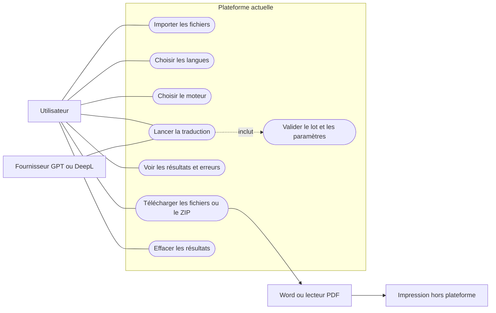
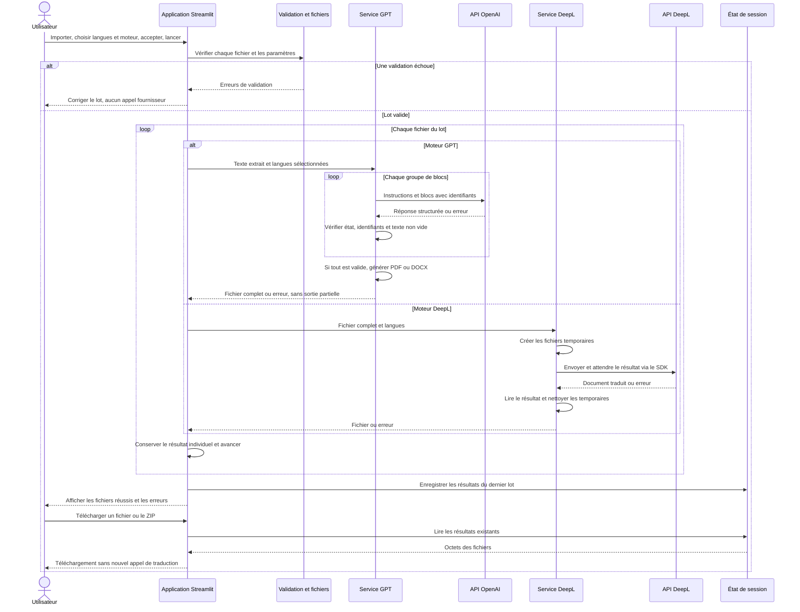
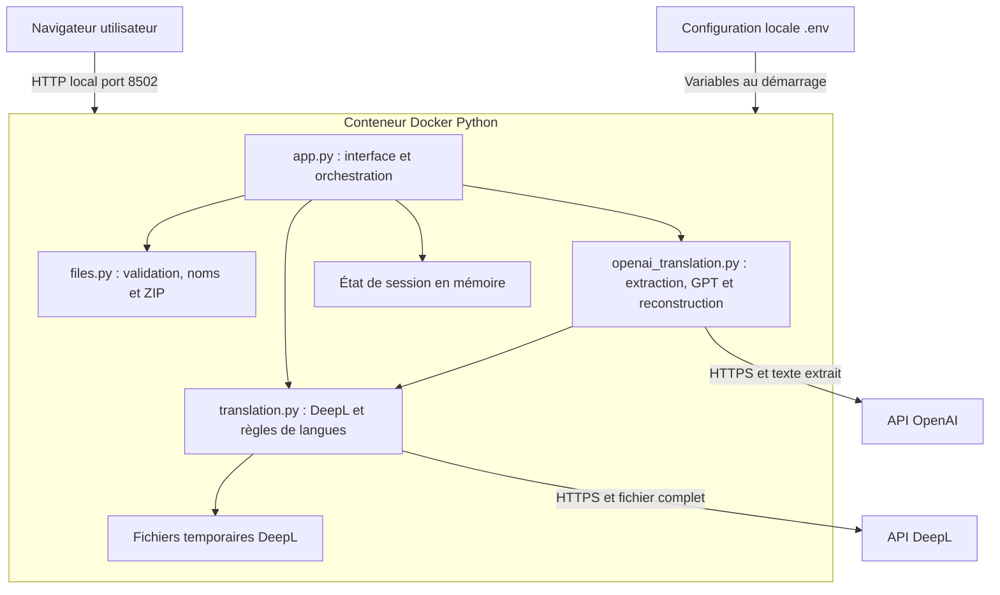
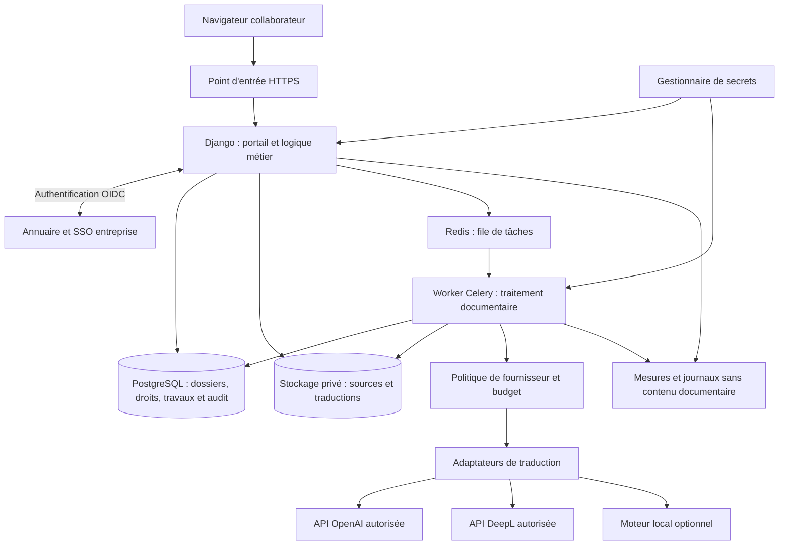
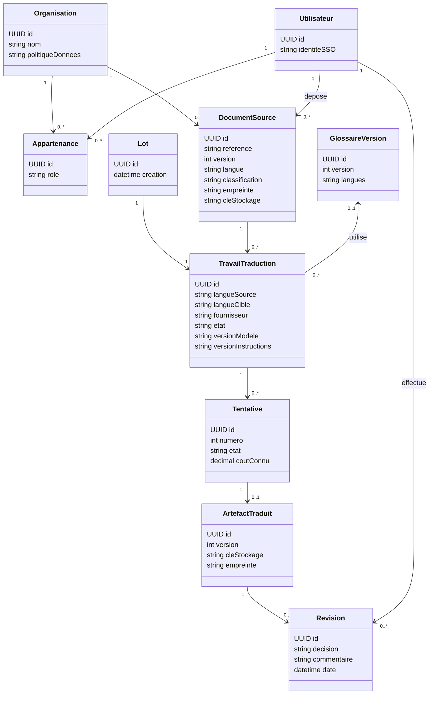
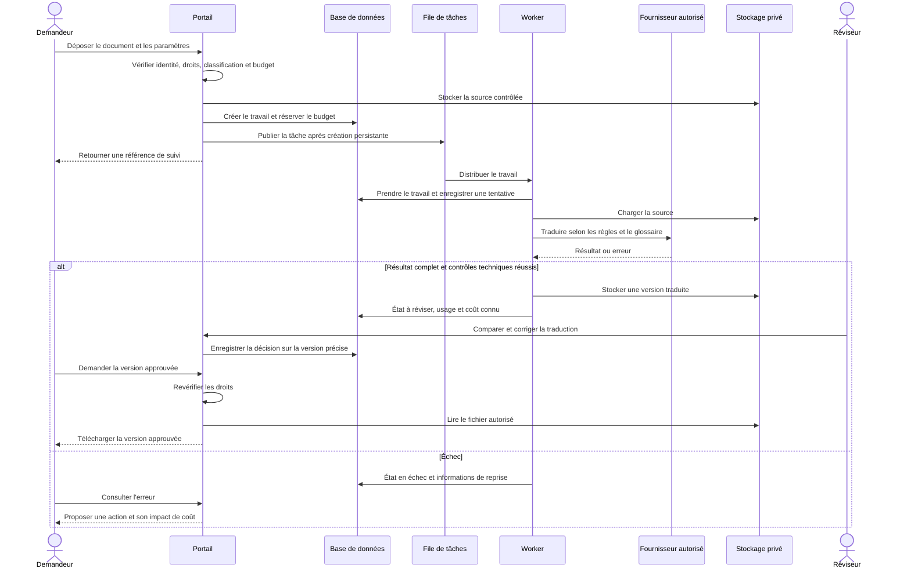
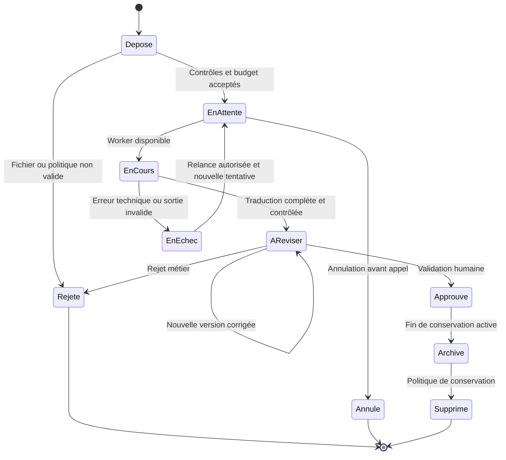

# Dossier de la plateforme de traduction documentaire

Évolution du 21 octobre 2026 sur `develop` : ajout de contrôles indicatifs des
nombres et références après traduction, d'un rapport téléchargeable et du
statut « brouillon à relire ». Un corpus fictif de 20 passages et un outil
d'évaluation hors ligne sont disponibles dans `evaluation/`. La validation
linguistique humaine, le glossaire et les autres évolutions entreprise décrites
plus bas restent à réaliser. Vérification après ces ajouts : 63 tests réussis
avec des fournisseurs simulés ; aucun nouvel appel de traduction réel.

Document de présentation, de conception et d'évolution vers un usage en entreprise.

Mise à jour : 20 octobre 2026. État décrit : prototype local Python et Streamlit, avec lancement Python et configuration Docker Compose. La dernière vérification porte sur le code et les tests ; aucun nouveau déploiement Docker ni appel réel de traduction n'a été effectué pendant le nettoyage. Les propositions d'évolution ci-dessous ne sont pas implémentées.

## 1. Présentation du projet

Le projet est une application web qui traduit des documents PDF ou Word entre le français, l'anglais, l'espagnol, l'allemand et le chinois simplifié. L'utilisateur importe plusieurs fichiers, choisit leur langue source, une langue de destination et un moteur de traduction : GPT via l'API OpenAI ou DeepL. Il télécharge ensuite les documents traduits, individuellement ou dans une archive ZIP, et peut les imprimer depuis Word ou son lecteur PDF.

La plateforme organise le parcours documentaire autour des moteurs de traduction existants. Elle ne développe pas son propre modèle d'intelligence artificielle. Sa valeur réside dans l'import multiple, les contrôles des fichiers, le choix du fournisseur, la récupération des résultats et, à terme, la traçabilité et la validation des traductions.

Le projet a été réalisé seule par Djamila. Il illustre une solution concrète combinant développement, intégration d'IA, traitement de données documentaires et automatisation d'un lot de fichiers clients à traduire. Le cadre et la période de réalisation restent à préciser pour une présentation externe.

Les échanges rapportés avec Nils chez Slash Consulting concernent des solutions destinées à faciliter les études, notamment dans un contexte ferroviaire, et la perspective d'un pôle data. La centralisation des fichiers dans une base de données a été évoquée comme suggestion. La réalisation actuelle couvre le parcours de traduction ; la centralisation persistante reste une évolution proposée, sans intégration aux systèmes de Slash à ce stade.

Trois documents fictifs à thème ferroviaire servent aux tests : fiche de suivi technique, rapport d'incident et coordination entre entreprises. Ils ne proviennent pas d'un client et ne constituent pas des procédures opérationnelles. L'application actuelle est généraliste et ne possède plus d'espace de simulation. Les exemples restent uniquement dans le projet local pour les tests ; leur ancien script de génération a été supprimé.

### Synthèse de l'état réalisé

| Dimension | Réalisation vérifiable |
| --- | --- |
| Développement | Interface Streamlit et services Python de validation, traduction et export |
| IA | Utilisation de l'API OpenAI avec blocs identifiés et réponses structurées ; aucun entraînement de modèle |
| Données documentaires | Lecture PDF/DOCX, extraction, découpage et reconstruction de fichiers |
| Automatisation | Traitement successif des fichiers après lancement utilisateur, progression et export ZIP |
| Qualité technique | Validation du lot avant envoi et rejet des réponses GPT structurellement incomplètes |
| Vérification | 52 tests réussis le 20 octobre 2026, avec clients fournisseurs simulés |
| Persistance | Résultats en session uniquement ; aucune base de données ni recherche documentaire |

## 2. Problématique et questions auxquelles le projet répond

**Problématique principale : comment permettre à un collaborateur de traduire plusieurs documents professionnels vers une autre langue avec un parcours simple, tout en maîtrisant leur qualité, leur confidentialité et le coût du traitement ?**

| Question | Réponse du prototype | Réponse à construire pour l'entreprise |
| --- | --- | --- |
| Comment éviter de copier chaque paragraphe dans un traducteur ? | Importer le document complet dans l'application | Ajouter des dépôts par dossier et des connecteurs à la gestion documentaire |
| Comment traduire dans les deux sens ? | Choisir la langue source et la langue cible | Ajouter une détection assistée et davantage de variantes linguistiques |
| Comment traiter plusieurs fichiers ? | Un lot de cinq fichiers maximum, traités successivement | Une file de travaux persistante avec un état par document |
| Comment choisir entre GPT et DeepL ? | L'utilisateur sélectionne le moteur | Appliquer une politique par type de document et niveau de confidentialité |
| Comment récupérer une sortie imprimable ? | PDF ou DOCX, puis téléchargement | Aperçu, comparaison, validation et diffusion de la version approuvée |
| Comment savoir si la traduction est fiable ? | Contrôles de structure de réponse et relecture externe | Glossaire métier, contrôles de contenu et validation par un réviseur |
| Comment savoir qui a traduit quoi ? | Pas d'identité ni d'historique persistant | Comptes, autorisations et journal des actions |
| Comment éviter les coûts imprévus ? | Limites locales et lancement explicite | Estimation, quotas, réservation de budget et suivi des coûts réels |

Le projet vise à réduire les opérations répétitives et à faciliter la circulation de documents entre équipes multilingues. Aucun gain de temps n'a été mesuré à ce stade. Une traduction automatique ne constitue pas, à elle seule, une validation technique ou une autorisation d'intervention.

## 3. Utilisateurs et besoins

### Utilisateur du prototype

Une personne disposant d'un document et d'un accès à l'application peut importer, configurer, traduire, télécharger et effacer les résultats de sa session. Aucun compte utilisateur n'est actuellement créé ou vérifié.

### Acteurs de la version entreprise proposée

| Acteur | Besoin | Responsabilité |
| --- | --- | --- |
| Collaborateur demandeur | Traduire ses documents et suivre leur avancement | Fournir le document, la langue et le contexte corrects |
| Réviseur métier | Comparer source et traduction | Corriger les termes et approuver ou rejeter une version |
| Responsable de service | Suivre l'activité de son équipe | Gérer les priorités et le budget du service |
| Administrateur fonctionnel | Configurer les langues, fournisseurs et glossaires | Appliquer les politiques de l'organisation |
| Exploitant informatique | Maintenir le service | Surveiller, sauvegarder, corriger et gérer les secrets |
| Responsable des données | Définir les règles de traitement | Valider les fournisseurs, les accès et les durées de conservation |
| Fournisseur de traduction | Traiter une requête autorisée | Retourner une traduction ou une erreur |

Une même personne peut avoir plusieurs rôles. Le rôle de réviseur ne doit pas automatiquement donner accès aux documents de toute l'entreprise.

## 4. Fonctionnalités actuelles et limites

| Fonction | Fonctionnement actuel |
| --- | --- |
| Formats d'entrée | PDF contenant du texte et Word `.docx` |
| Import multiple | Jusqu'à 5 fichiers par lot, 5 Mo par fichier |
| Langue source | Choix manuel parmi les cinq langues |
| Langue cible | Même ensemble ; anglais britannique en sortie |
| Langues identiques | Traduction désactivée et contrôle dans les services |
| Lot | Une langue source, une langue cible et un moteur communs |
| DeepL | Transmission du fichier complet et récupération du résultat |
| GPT | Extraction du texte, traduction structurée, génération d'un nouveau document |
| Sortie | Format d'origine : PDF vers PDF, DOCX vers DOCX |
| Téléchargement | Un fichier à la fois ou ZIP des résultats réussis |
| Échec d'un fichier chez le fournisseur | Les autres fichiers du lot continuent |
| Échec de validation initiale | Aucun fichier du lot n'est envoyé avant correction |
| Impression | Depuis le logiciel ouvrant le fichier téléchargé |
| Historique | Dernier lot conservé dans l'état de session, sans base de données |
| Exécution | Lancement Python local ou configuration Docker Compose exposée sur `http://localhost:8502` |

Les PDF protégés et les PDF sans texte exploitable sont refusés. Les images seules et les anciens fichiers Word `.doc` ne font pas partie du périmètre. La vérification de taille d'un DOCX décompressé est limitée à 50 Mo.

GPT est limité à 60 000 caractères extraits par document. Les requêtes sont limitées à 6 000 caractères et 40 blocs, avec au maximum 8 000 tokens de sortie par requête. Caractères et tokens sont deux unités différentes : ces limites ne garantissent pas qu'une traduction ne sera jamais tronquée.

GPT recrée une présentation simple. Les images, la présentation des tableaux, les styles, les en-têtes et pieds de page ne sont pas conservés. DeepL cherche à conserver la structure documentaire, mais la fidélité réelle doit être vérifiée sur chaque famille de documents.

## 5. Comment les informations sont choisies

### Informations choisies par l'utilisateur

L'utilisateur choisit les fichiers, leur langue source, la langue cible et le moteur. Le programme ne vérifie pas actuellement que la langue déclarée correspond à la langue réelle du fichier. Un lot contenant des langues différentes doit donc être séparé en plusieurs lots.

La case d'accord informe l'utilisateur de l'envoi du contenu au fournisseur et de la consommation du quota API. Pour l'entreprise, cette case ne remplace pas la politique interne de traitement des données ni la validation du contrat fournisseur.

### Informations extraites par le programme

Avec DeepL, le programme transmet le fichier complet. Avec GPT, le programme extrait le texte du PDF en regroupant les lignes de paragraphes, ou parcourt le corps du DOCX et les cellules des tableaux. Il conserve l'ordre obtenu par l'extraction. Un PDF complexe ou à plusieurs colonnes peut produire un ordre de lecture incorrect.

Le programme ne choisit pas uniquement les passages « intéressants » et ne demande pas un résumé : son objectif est de traduire tout le texte extrait. Chaque bloc reçoit un identifiant technique pour rattacher la réponse au bon passage. La présence de chaque bloc et l'absence de valeurs vides sont contrôlées avant génération du document.

Ces contrôles garantissent une structure exploitable, pas l'exactitude du sens. Un identifiant présent peut contenir une traduction incorrecte, une omission interne ou un terme métier mal choisi.

### Informations configurées par l'exploitant

Les clés `OPENAI_API_KEY` et `DEEPL_API_KEY` sont fournies côté serveur. Le modèle GPT est configuré via `OPENAI_MODEL`, avec `gpt-4.1-mini` comme valeur par défaut dans le projet. Les clés ne sont pas des informations à afficher dans le navigateur ou à inclure dans les documents.

### Informations à ajouter pour l'entreprise

Ajouter le propriétaire du fichier, le service, le projet métier, la classification de confidentialité, la version du document, le glossaire, la date limite et le besoin de validation humaine. Chaque champ doit avoir une utilité : décision d'accès, routage, suivi, contrôle ou audit. Éviter les formulaires longs qui ne modifient aucune décision.

## 6. Comment les informations sont liées

Dans le prototype, le lien est réalisé par le traitement en mémoire : fichier importé → paramètres du lot → texte ou fichier transmis → résultat → nom de sortie. L'état de session conserve les résultats et les choix du dernier lot. Il n'existe pas d'identifiant métier persistant pour suivre le document après fermeture de la session.

Dans une entreprise, distinguer les objets suivants :

| Objet | Contenu | Relation principale |
| --- | --- | --- |
| Organisation | Entreprise ou périmètre d'isolation | Possède des membres et des documents |
| Utilisateur | Identité du collaborateur | Appartient à une organisation avec un rôle |
| Document source | Référence, version, propriétaire, langue, empreinte | Peut être traduit plusieurs fois |
| Lot | Groupe de demandes lancé ensemble | Contient plusieurs travaux |
| Travail de traduction | Document, langues, moteur, état | Produit un résultat ou une erreur |
| Tentative | Un essai de traitement et ses requêtes fournisseur | Appartient à un travail |
| Artefact traduit | Fichier et version de sortie | Résulte d'une tentative réussie |
| Révision | Décision et corrections humaines | Porte sur une version précise de sortie |
| Glossaire versionné | Termes métier et traductions approuvées | Peut être utilisé par plusieurs travaux |
| Événement d'audit | Action, acteur, date, objet | Retrace la vie du document et du travail |

Exemple : un PDF anglais appartient au service maintenance. Il est inclus dans un lot de trois fichiers et associé à un travail anglais → français avec DeepL. Une première tentative échoue ; une seconde produit une version française. Le réviseur approuve cette version. L'approbation doit rester attachée à cette version, pas être transférée automatiquement à une traduction ultérieure.

## 7. Diagramme des cas d'utilisation du prototype

Ce schéma représente les acteurs et cas d'utilisation selon une lecture UML. Mermaid n'a pas de notation native complète de cas d'utilisation : les ovales et les liens sont représentés avec un diagramme de flux. L'accord et les contrôles font partie du lancement ; aucune connexion utilisateur n'existe à ce stade.



## 8. Diagramme de séquence du prototype

Le fichier est contrôlé avant tout appel facturable. Les branches GPT et DeepL sont alternatives : l'application n'envoie pas automatiquement un document aux deux fournisseurs.



Si une requête GPT échoue, les requêtes précédentes du même document peuvent déjà être facturées. Le prototype ne reprend pas au bloc interrompu. L'utilisateur relance manuellement le document concerné.

## 9. Architecture actuelle et responsabilités



La flèche du service GPT vers `translation.py` correspond à l'import des règles de langues communes. Cela ne signifie pas que GPT appelle DeepL.

| Fichier | Rôle |
| --- | --- |
| `app.py` | Interface, validation du lot, lancement et affichage |
| `services/files.py` | Contrôles PDF/DOCX, noms de sortie et archive ZIP |
| `services/translation.py` | Langues, appel DeepL et messages d'erreur fournisseur |
| `services/openai_translation.py` | Extraction, découpage, appel GPT, validation et création des fichiers |
| `requirements.txt` | Dépendances de l'application |
| `requirements-dev.txt` | Dépendances applicatives et pytest ; dépendance inutilisée `pymupdf` retirée |
| `start.ps1` | Préparation de l'environnement Python et lancement local |
| `pytest.ini` | Configuration de découverte des tests |
| `.env.example` | Noms des paramètres à configurer, sans clés réelles |
| `.streamlit/config.toml` | Limite d'import et présentation |
| `Dockerfile` | Construction de l'image et lancement avec un utilisateur non root |
| `compose.yaml` | Exposition locale, injection des paramètres et redémarrage |
| `.dockerignore` | Exclusion des secrets, du dossier virtuel et des fichiers inutiles au build |
| `tests/` | Vérifications fonctionnelles et tests avec fournisseurs simulés |
| `examples/` | Trois PDF fictifs utilisés par les tests, absents de l'image Docker |
| `.gitignore` | Exclusion de `.env`, de l'environnement virtuel, des caches, de l'historique et des temporaires |
| `README.md` | Installation, lancement et utilisation |
| `DOSSIER_PROJET_ET_ARCHITECTURE.md` | État réalisé et propositions d'architecture |

L'organisation est adaptée à un prototype : un seul langage principal, peu de composants et aucun stockage persistant à administrer. Elle atteint ses limites lorsque plusieurs utilisateurs doivent conserver leurs dossiers, reprendre un travail interrompu ou partager une validation.

### Nettoyage réalisé le 20 octobre 2026

- Suppression de `scripts/generate_examples.py`, puis du dossier `scripts/` qui ne contenait plus que son cache compilé.
- Suppression des caches Python, du cache pytest, des répertoires résiduels `pytest-cache-files-*` et du dossier temporaire `tmp/`, comprenant les anciens fichiers de travail et de contrôle.
- Suppression de `.history/`, qui contenait d'anciennes copies locales de `.env`. Le fichier `.env` actif a été conservé.
- Retrait de `pymupdf` de `requirements-dev.txt`, sans import ni utilisation dans l'application ou les tests actuels. Cela ne désinstalle pas automatiquement un paquet déjà présent dans `.venv`.
- Ajout de `.history/` et `pytest-cache-files-*/` aux exclusions Git. Suppression des instructions de génération des exemples dans le README.

La revue des imports et des appels n'a identifié aucune fonction applicative inutilisée à retirer. Les trois PDF d'exemple sont conservés, car ils sont lus par les tests. L'environnement `.venv`, les tests et les configurations de lancement restent utiles au projet.

## 10. Stack actuelle et justification

| Technologie | Utilisation | Pourquoi elle convient au prototype |
| --- | --- | --- |
| Python | Logique de traitement | Écosystème documentaire et SDK des fournisseurs |
| Streamlit | Interface et serveur | Interface rapide sans frontend séparé |
| SDK OpenAI | API Responses et sorties structurées | Traduction des blocs identifiés |
| SDK DeepL | Traduction documentaire | Envoi d'un fichier complet |
| pypdf | Lecture et contrôles PDF | Extraction du texte et inspection du document |
| python-docx | Lecture et écriture Word | Parcours du corps, tableaux et création DOCX |
| ReportLab | Création PDF | Génération de pages imprimables et support CJK configuré |
| python-dotenv | Configuration locale | Chargement des paramètres du projet |
| Bibliothèque standard Python | ZIP, octets et fichiers temporaires | Peu de dépendances supplémentaires |
| Docker et Compose | Déploiement local | Environnement reproductible et lancement simple |
| pytest et Streamlit AppTest | Tests | Validation des règles et du parcours utilisateur |

Le conteneur utilise Python 3.13. Aucun serveur de base de données, stockage objet, mécanisme SSO ou système de file de tâches n'est présent dans l'architecture actuelle. Docker facilite le déploiement ; il ne fournit pas à lui seul ces fonctions.

## 11. Choisir GPT ou DeepL en entreprise

Le meilleur fournisseur dépend du document, du contrat de traitement et des résultats d'évaluation. Le prototype donne le choix à l'utilisateur ; une entreprise peut devoir restreindre ce choix.

| Critère | GPT dans l'implémentation actuelle | DeepL dans l'implémentation actuelle |
| --- | --- | --- |
| Document complet | Texte extrait localement et document recréé | Fichier transmis et résultat récupéré |
| Présentation | Simplifiée, images et styles perdus | Préservation à évaluer sur les documents réels |
| Instructions personnalisées | Instructions de traduction configurables | Paramètres et options documentaires du fournisseur |
| Glossaire métier | Pas de glossaire branché actuellement | Pas de glossaire branché actuellement |
| Validation du résultat | Contrôles JSON, blocs présents et non vides | Succès de récupération du fichier ; pas d'évaluation linguistique locale |
| Confidentialité | Dépend des règles de l'API et du compte | Dépend du produit et du contrat DeepL choisis |
| Coût | Tokens d'entrée et de sortie selon le modèle | Usage documentaire selon le plan et les limites fournisseur |

Proposition : choisir DeepL pour les documents dont la présentation doit être conservée, après validation sur un échantillon représentatif. Choisir GPT pour les documents simples nécessitant des instructions de contexte, après évaluation de la fidélité des termes et des nombres. Pour un document dont l'envoi externe est interdit par l'organisation, aucun des deux moteurs cloud ne doit être utilisé ; prévoir un moteur local approuvé ou un traitement humain.

Le fournisseur de secours ne doit jamais recevoir automatiquement le document sans être autorisé par la même politique de données. Une panne n'annule pas les règles de confidentialité.

## 12. Quelle stack privilégier pour une entreprise

**Pour une petite ou moyenne équipe qui veut une application interne durable sans multiplier les technologies, je recommande Python avec Django, des pages HTML rendues côté serveur et PostgreSQL.** Ajouter un worker et un stockage objet lorsque les volumes, les reprises et les besoins d'historique le justifient. Cette recommandation est un choix d'architecture pour ce projet, pas une règle générale.

Django apporte un système d'authentification et de permissions ainsi qu'un site d'administration. Le SSO d'entreprise nécessite une intégration supplémentaire ; il n'est pas automatiquement fourni par ces briques. L'administration Django sert aux utilisateurs de confiance qui gèrent les données, pas à remplacer l'interface métier des collaborateurs. [Authentification Django](https://docs.djangoproject.com/en/5.2/topics/auth/), [administration Django](https://docs.djangoproject.com/en/5.2/ref/contrib/admin/).

| Niveau | Stack proposée | Cas adapté | Coût de complexité |
| --- | --- | --- | --- |
| Démonstration actuelle | Streamlit + SDK + Docker | Validation du besoin, usage local | Faible |
| Pilote interne limité | Streamlit derrière un accès protégé, budgets et suivi minimal | Petit groupe supervisé, documents autorisés | Modéré ; état de session encore fragile |
| Application interne durable | Django + templates HTML + PostgreSQL | Comptes, historique, droits et validation métier | Modéré, davantage de développement backend |
| Traitements documentaires persistants | Même application + Celery et Redis + stockage objet privé | Lots longs, reprise et plusieurs utilisateurs | Exploitation de services supplémentaires |
| Produit très interactif ou API pour plusieurs clients | React/TypeScript + FastAPI + PostgreSQL + workers | Éditeur de comparaison avancé et intégrations externes | Plus élevé, frontend et backend séparés |

FastAPI est une bonne option pour une architecture centrée sur une API : il produit notamment une documentation OpenAPI. Le projet devra néanmoins construire ou intégrer l'administration, le workflow et l'identité. Pour un simple portail interne, React et FastAPI ne sont pas indispensables. [Fonctions FastAPI](https://fastapi.tiangolo.com/features/).

Ne pas introduire Kubernetes ou plusieurs microservices pour le seul motif de « faire entreprise ». Une application modulaire avec un processus web et un worker séparés constitue une base suffisante pour de nombreux projets internes. La disponibilité attendue et la charge mesurée guideront ensuite l'hébergement.

## 13. Architecture entreprise proposée

Les composants suivants constituent une cible, pas l'état actuel du projet.



Le portail autorise la demande et affiche l'avancement. Le worker effectue le traitement long. PostgreSQL garde l'état et les relations. Le stockage objet garde les fichiers ; Redis ne doit pas devenir l'unique source de vérité des travaux. Les adaptateurs cachent les différences entre fournisseurs derrière un contrat commun.

Pour commencer, l'ensemble peut être déployé sur une infrastructure interne ou un hébergement géré, avec HTTPS, sauvegardes et accès protégés. Une seule machine reste un point de panne ; des composants gérés ou redondants seront nécessaires si l'objectif de disponibilité l'exige.

## 14. Organisation proposée du code entreprise

```text
platforme/
├── config/                     # Paramètres applicatifs et routes
├── accounts/                   # Identités, organisations et appartenances
├── documents/                  # Sources, versions et règles d'accès
├── translations/               # Travaux, états et orchestration métier
│   ├── providers/              # OpenAI, DeepL et futur moteur local
│   ├── extraction/             # PDF, DOCX et OCR éventuel
│   ├── rendering/              # Génération et contrôle des sorties
│   ├── quality/                # Nombres, termes et complétude
│   └── tasks.py                # Entrée des tâches worker
├── reviews/                    # Comparaison, corrections et approbation
├── glossaries/                 # Termes métier et versions
├── audit/                      # Événements d'accès et de traitement
├── templates/                  # Pages HTML du portail
├── static/                     # CSS et interactions du navigateur
├── tests/                      # Métier, isolation, intégration et documents
├── deploy/                     # Docker, proxy et configurations de déploiement
└── docs/                       # Architecture et procédures d'exploitation
```

Principes : l'interface ne doit pas appeler directement les SDK fournisseurs ; les règles de langue et de confidentialité sont centralisées ; les extracteurs ne décident pas des droits ; les renderers ne décident pas du budget. Les adaptateurs renvoient un résultat normalisé avec état, identifiant de requête, usage connu et erreur classée.

Un fichier de domaine commun pour les langues et les erreurs évitera que le service GPT importe des règles depuis un module portant le nom d'un autre fournisseur. Ce refactoring est une amélioration proposée, pas une modification effectuée par ce dossier.

## 15. Diagramme UML du modèle métier proposé

Les classes ci-dessous représentent les concepts d'une future version persistante. Elles ne correspondent pas à des tables déjà créées.



Une tentative peut comporter plusieurs requêtes GPT. Dans une conception détaillée, ajouter une entité `RequeteFournisseur` pour leurs identifiants, états et usages. Les secrets et le texte documentaire ne doivent pas être copiés dans ces métadonnées de suivi.

## 16. Séquence entreprise proposée



Une transaction PostgreSQL et l'envoi vers Redis ne sont pas une opération atomique unique. Prévoir une publication après commit avec réconciliation, ou une table d'événements à publier, pour éviter un travail enregistré mais jamais envoyé. Le worker doit supporter une livraison répétée de tâche sans lancer automatiquement une seconde traduction facturée.

## 17. Cycle de vie proposé d'un travail



Annuler un travail en cours ne garantit pas que le fournisseur n'a pas déjà consommé du crédit. Une correction du document source doit créer une nouvelle version et une nouvelle demande, pour préserver l'historique.

## 18. Sécurité et traitement des données

Priorités proposées :

1. Authentifier les collaborateurs et contrôler les droits sur chaque document, résultat et téléchargement.
2. Isoler les services ou organisations : un identifiant difficile à deviner ne remplace pas une autorisation serveur.
3. Stocker les fichiers dans un espace privé, chiffré selon les capacités de l'hébergement, avec une durée de conservation définie.
4. Fournir les secrets avec un gestionnaire dédié en production et prévoir leur rotation. Les variables d'environnement locales ne constituent pas une politique complète de gestion des secrets.
5. Vérifier les fichiers avant traduction : signature réelle, contenu, taille décompressée, malware et limites de ressources des parseurs.
6. Mettre les traitements documentaires à risque dans un environnement isolé, avec temps et mémoire limités.
7. Journaliser les actions et erreurs sans enregistrer les clés, documents complets ou traductions dans les logs techniques.
8. Définir avec les responsables concernés les documents qui peuvent sortir du système d'information et les fournisseurs autorisés.

Les données de l'API OpenAI ne sont pas utilisées pour l'entraînement par défaut, sauf participation explicite au partage. Toutefois, `store=False` ne constitue pas une garantie générale de rétention nulle : les règles de surveillance des abus et les options de compte doivent être examinées. [Documentation officielle OpenAI sur les données](https://developers.openai.com/api/docs/guides/your-data).

La politique DeepL décrit des garanties spécifiques pour ses services Pro, dont API Pro. Elles ne doivent pas être extrapolées automatiquement à tous les services gratuits ou à un contrat non vérifié. [Politique de confidentialité DeepL](https://www.deepl.com/en/privacy).

Pour des documents comportant des données personnelles ou confidentielles, faire valider la base de traitement, les contrats, les destinations, les accès et les durées de conservation avant l'ouverture du service. Cette étape relève de l'organisation ; ce dossier ne certifie aucune conformité réglementaire.

## 19. Qualité de traduction et contexte ferroviaire

La qualité a trois dimensions différentes : fichier exploitable, contenu complet et sens correct. Un PDF qui s'ouvre n'est pas nécessairement une traduction approuvée.

| Contrôle proposé | Exemple | Action |
| --- | --- | --- |
| Présence des passages | Tous les identifiants ont une réponse | Bloquer les sorties structurellement incomplètes |
| Nombres et références | RN 204, 08 h 30, ST 2026 014 | Signaler une modification ou omission |
| Unités et valeurs | Température, durée, distance | Comparer selon les règles de conversion approuvées |
| Glossaire métier | Porte, défaut, contrôle, consignation | Appliquer des termes approuvés par le métier |
| Négations et obligations | « Ne pas utiliser », « doit », « peut » | Prioriser la relecture des passages concernés |
| Présentation | Tableau tronqué, caractères chinois manquants | Bloquer ou demander correction |
| Source de mauvaise qualité | Scan illisible ou ordre de colonnes incertain | Demander une meilleure source ou une validation renforcée |

Construire un corpus d'évaluation avec des documents représentatifs et des traductions approuvées : courts et longs, tableaux, accents, chinois, unités, références et négations. Évaluer GPT et DeepL sur ce corpus plutôt que choisir un moteur uniquement sur sa réputation.

Pour une fiche ferroviaire pouvant influencer une décision opérationnelle, prévoir une relecture par une personne compétente et afficher clairement le statut « brouillon automatique » tant que la validation n'a pas été obtenue. Le glossaire doit être validé par les métiers ; une correspondance de mots ne suffit pas à résoudre tous les contextes.

## 20. Coûts, reprise et disponibilité

Le coût complet comprend les appels de traduction, l'OCR éventuel, le stockage, l'hébergement, les sauvegardes, la supervision et le temps de relecture. Comparer également le coût d'une traduction inutilisable qu'il faut recommencer.

Propositions : estimation avant lancement, quotas par service, plafond par document, alertes et enregistrement de l'usage réel renvoyé par les fournisseurs. Les tarifs doivent être consultés au moment du dimensionnement ; ce dossier ne fixe pas de montant commercial.

Pour les reprises GPT, conserver les blocs réussis et leur version de source afin de reprendre uniquement les blocs manquants lorsque la politique de conservation l'autorise. Inclure dans l'identité du travail l'empreinte du document, les langues, le fournisseur, le modèle, le glossaire et les instructions. Deux demandes différentes ne doivent pas partager silencieusement un résultat.

Ne pas promettre un traitement « exactement une fois » au seul moyen d'une file de tâches. Les délais réseau et réponses incertaines doivent être gérés explicitement. Conserver les références fournisseur lorsqu'elles existent, ne pas multiplier les appels à l'aveugle et expliquer le risque de coût d'une relance.

Mesures utiles : temps d'attente, durée de traitement, taux d'erreur par moteur, taux de reprise, coût par document, corrections humaines et nombre de travaux bloqués. La disponibilité doit être définie avec l'entreprise, puis testée ; un healthcheck HTTP seul ne prouve pas que la traduction fonctionne.

## 21. Améliorations prioritaires et critères d'acceptation

| Priorité | Amélioration | Critère concret de réussite |
| --- | --- | --- |
| P0 avant ouverture à un groupe | Accès authentifié et autorisations | Un utilisateur ne peut ni lire ni télécharger le document d'un autre périmètre |
| P0 | Politique des fournisseurs et données | Un document interdit d'envoi externe ne déclenche aucun appel cloud |
| P0 | Budget et limites | Un quota dépassé bloque le lancement avant un appel facturable |
| P0 | Validation de traduction sensible | Un brouillon ne peut pas être présenté comme version approuvée |
| P1 | Travaux persistants et workers | Fermer le navigateur ne perd pas le suivi et ne relance pas la traduction |
| P1 | Historique et audit | Retrouver source, version, moteur, langue, acteur et décision |
| P1 | Reprise maîtrisée | Un doublon de tâche n'entraîne pas un nouvel appel injustifié |
| P1 | Glossaire et contrôles métier | Les écarts sur termes, nombres et références sont visibles pour le réviseur |
| P1 | Comparaison source/traduction | Le réviseur corrige et approuve une version identifiable |
| P2 | OCR | Les scans de test produisent un texte contrôlable, avec signalement des zones incertaines |
| P2 | Fidélité documentaire | Images, tableaux et styles sont évalués sur un corpus avant diffusion |
| P2 | Détection assistée de langue | Une langue détectée est proposée et peut être corrigée par l'utilisateur |
| P2 | Connecteurs documentaires | Import et dépôt dans un espace autorisé sans contourner ses droits |
| P3 selon usage | Plusieurs cibles par demande | Un travail et un coût distincts sont suivis pour chaque langue cible |

Les priorités sont proposées pour ce projet. Leur ordre doit être ajusté à la sensibilité des documents, au nombre d'utilisateurs et à l'organisation existante.

## 22. Organisation du travail et feuille de route

### Étape A — Valider le besoin

Identifier les utilisateurs, familles de documents, langues, volumes, délais et niveaux de confidentialité. Constituer le corpus d'évaluation. Décider qui valide les traductions et quels fournisseurs peuvent recevoir les documents.

### Étape B — Préparer un pilote contrôlé

Protéger l'accès, fixer les budgets, documenter les limites et organiser la relecture. Utiliser les mesures du pilote pour décider si Streamlit reste suffisant ou si un portail persistant est nécessaire.

### Étape C — Construire le socle entreprise

Ajouter les identités, documents versionnés, travaux persistants, stockage privé et workers. Migrer progressivement les services de traduction existants ; conserver les tests de langues, de fichiers et de résultats incomplets.

### Étape D — Renforcer la qualité et l'exploitation

Ajouter glossaires, contrôle des nombres, comparaison, approbation, sauvegarde et restauration testée. Automatiser les contrôles en intégration continue, construire une image versionnée et séparer développement, test et production.

### Étape E — Étendre selon les usages observés

Ajouter OCR, meilleures restitutions, plusieurs langues cibles et connecteurs. N'introduire une architecture distribuée plus complexe qu'après identification d'un besoin réel de charge ou de disponibilité.

Répartition conseillée : le responsable produit fixe les priorités ; les métiers valident le glossaire et la qualité ; le développement réalise le portail et les tests ; l'exploitation gère le déploiement et les incidents ; les responsables des données valident les politiques de traitement.

## 23. Plan de vérification entreprise

| Famille | Vérifications attendues |
| --- | --- |
| Fonctionnel | Import, langues dans les deux sens, choix fournisseur, téléchargements et erreurs individuelles |
| Documents | PDF textuels et scans, DOCX avec tableaux, caractères chinois, fichiers corrompus et trop volumineux |
| Qualité | Références, nombres, unités, négations, glossaire et fidélité du sens |
| Sécurité | Authentification, accès interservices, téléchargements, secrets et fichiers malveillants |
| Reprise | Arrêt worker, interruption réseau, doublon de tâche, réponse fournisseur incertaine |
| Coûts | Estimation, plafonds, appels multiples, relance et consommation réelle |
| Exploitation | Restauration de sauvegarde, rotation de clé, purge, déploiement et retour à une version précédente |
| Charge | Plusieurs utilisateurs et lots simultanés sans mélange de résultats |

### Vérification du prototype après nettoyage

Le 20 octobre 2026, les **52 tests ont réussi en 12,01 secondes**, avec la commande suivante depuis la racine :

```powershell
.\.venv\Scripts\python.exe -B -m pytest -q -p no:cacheprovider --tb=short
```

Le premier lancement en environnement restreint donnait 31 réussites et 21 échecs de permissions lors de l'écriture ou du nettoyage des dossiers temporaires Windows. La même suite a ensuite réussi hors de ces restrictions. Aucun changement de logique applicative n'a été nécessaire pour cette vérification.

Les tests couvrent notamment les paires de langues DeepL avec un client simulé, le refus des langues identiques, l'extraction Word et PDF, les limites de découpage, les réponses GPT incomplètes ou vides, les sorties PDF dans plusieurs langues dont le chinois, les noms de fichiers, le ZIP, le nettoyage des temporaires et des comportements de l'interface Streamlit.

Les fournisseurs sont simulés : cette exécution n'envoie aucun document et ne consomme aucun crédit de traduction. Elle ne valide pas la disponibilité d'un compte API, la qualité linguistique réelle, la charge ou la sécurité d'une version entreprise.

Le dossier antérieur mentionnait un essai réel français vers anglais avec OpenAI et une vérification visuelle du PDF. Cet essai n'a pas été reproduit pendant cette mise à jour. Avant une démonstration, vérifier le fournisseur choisi, le rendu du document et les conditions réseau. Les appels DeepL réels et l'ensemble des langues restent à vérifier sur un corpus représentatif.

## 24. Présentation courte pour un entretien technique

« J'ai réalisé seule une plateforme de traduction de documents PDF et Word pour traiter plusieurs fichiers dans un même parcours. L'utilisateur importe les documents, choisit la langue source, la langue cible et le moteur GPT ou DeepL, puis récupère les résultats individuellement ou dans une archive ZIP.

Le prototype utilise Python et Streamlit. GPT traduit le texte extrait et reconstruit un document ; DeepL traite le fichier complet. Le parcours associe développement, intégration d'IA, traitement documentaire et automatisation. Les fichiers sont contrôlés avant envoi et les réponses GPT incomplètes sont rejetées. Après nettoyage du projet, les 52 tests automatisés passent avec des fournisseurs simulés.

Vous aviez également évoqué une base de données pour centraliser les fichiers. Aujourd'hui, les résultats restent en session. Je proposerais ensuite un espace documentaire pour classer les fichiers par client et projet, conserver les versions et retrouver leurs traductions. Une conception possible associerait un stockage privé pour les fichiers et une base de données pour leurs métadonnées et liens, avec des droits d'accès et une validation métier adaptés. »

## 25. Sources et statut du dossier

Les descriptions de l'existant reposent sur la lecture de `app.py`, des trois modules de `services/`, du `Dockerfile`, de `compose.yaml` et de `requirements.txt`. Les diagrammes entreprise et la stack cible sont des propositions de conception.

Les sources externes sont reliées aux affirmations correspondantes dans le dossier. Références utiles complémentaires :

- [PostgreSQL : politiques de sécurité par ligne](https://www.postgresql.org/docs/current/ddl-rowsecurity.html) — mécanisme possible en complément des contrôles applicatifs ; sa configuration et les rôles privilégiés doivent être examinés.
- [OpenAI : sorties structurées](https://developers.openai.com/api/docs/guides/structured-outputs) — contrôle de la forme de réponse, distinct de l'exactitude linguistique.
- [DeepL : langues disponibles](https://developers.deepl.com/docs/getting-started/supported-languages) — disponibilité à confirmer pour le produit et les fonctionnalités retenus.

Cette mise à jour documentaire décrit le nettoyage déjà effectué, dont le retrait d'une dépendance de développement inutilisée. Elle n'ajoute aucune fonctionnalité, ne modifie pas les clés et ne redéploie pas l'application. Les blocs Mermaid peuvent être visualisés dans un lecteur Markdown compatible ; sinon, ils restent accessibles sous forme textuelle.
