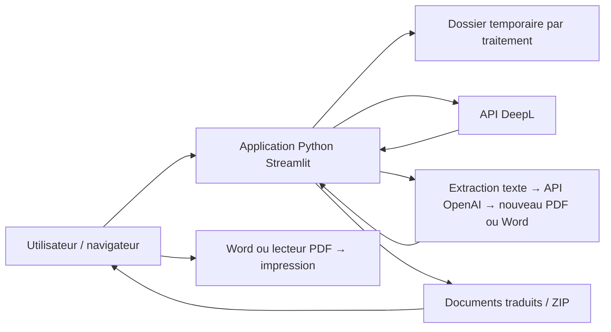

# Espace de traduction de documents

## Guide rapide et documentation

Le prototype traduit des PDF et Word entre français, anglais britannique,
espagnol et allemand. Il propose un glossaire local
optionnel et des rapports de contrôle. Tous les résultats sont des
**brouillons à relire**. Il n'y a pas de base de données.

| Pour comprendre ou modifier… | Lire ou ouvrir… |
| --- | --- |
| L'organisation du code et le parcours complet | [Architecture actuelle](docs/architecture.md) |
| Les 55 notions proposées dans les quatre langues | [data/glossaries/technical.json](data/glossaries/technical.json) |
| L'utilisation, les variantes et la validation du glossaire | [Guide du glossaire](docs/glossary.md) |
| La conservation des tableaux et images Word | [Traduction Word](docs/word-translation.md) |
| Ce que prouvent les mocks et les limites des contrôles | [Qualité et tests](docs/quality-and-tests.md) |
| La vérification du sens à la demande | [Analyse du sens](docs/semantic-review.md) |
| La traduction naturelle et le découpage avec contexte | [Sens, chunks et vecteurs](docs/translation-context.md) |
| Les essais réels et la relecture humaine | [Protocole d'évaluation](evaluation/README.md) |
| Les évolutions vers une utilisation entreprise | [Dossier détaillé](docs/DOSSIER_PROJET_ET_ARCHITECTURE.md) |
| Les choix prioritaires pour un portail entreprise | [Recommandations entreprise](docs/enterprise.md) |

### Utiliser le glossaire, étape par étape

1. Choisir les langues et le moteur. Ouvrir **Voir le glossaire et son utilisation**.
2. Vérifier les termes proposés et leur contexte. Cocher **Utiliser le glossaire
   technique** si souhaité ; l'option est désactivée par défaut.
3. Importer les documents, accepter leur envoi au moteur et lancer le lot.
4. Ouvrir **Contrôles** sous chaque résultat. Le rapport peut signaler un
   nombre, une référence ou un terme attendu absent de la traduction.
5. Télécharger le rapport JSON pour conserver le moteur, les langues, les
   alertes et l'identifiant, version, statut et empreinte SHA-256 du glossaire.
6. Relire le document avec une personne bilingue et compétente sur le métier.

| Moteur | Aide du glossaire avant traduction | Contrôle après traduction |
| --- | --- | --- |
| GPT | Termes utiles et contexte ajoutés aux consignes de chaque lot | Présence des variantes cibles |
| DeepL | Aucun glossaire natif transmis dans cette version | Même contrôle local des termes |

Le fichier fourni porte le statut **proposed** : ses traductions sont des
propositions, sans validation métier. Le contrôle n'est pas un remplacement
automatique de mots. Des variantes grammaticales ou des paraphrases correctes
peuvent être signalées. La présence des termes ne garantit pas le sens.
GPT reçoit un peu plus de contexte : aucun appel supplémentaire n'est créé,
mais le coût du texte d'entrée peut augmenter. Mesurer l'effet avec des
essais avant/après plutôt que promettre un gain de qualité.

Pour modifier le vocabulaire, éditer le JSON en UTF-8, renseigner les quatre
langues, préciser le contexte, augmenter la version et relancer les tests.
Les étapes et conditions de validation sont dans le [guide](docs/glossary.md).
Pour voir les changements dans l'application Docker, reconstruire avec
`docker compose up -d --build`. Les tests Docker lisent directement les
fichiers locaux, y compris le glossaire.

## Contrôle de qualité et évaluation

Dans **Comparer les textes**, **Analyser le sens** permet maintenant de
demander un avis IA sur les contresens, négations inversées, omissions et
ajouts. L'option exige un consentement distinct et un appel OpenAI payant,
même après traduction DeepL. Limite : 12 000 caractères par texte, sans
troncature. L'avis et les citations restent à confirmer humainement ; il ne
constitue pas une approbation. Voir [les étapes et limites](docs/semantic-review.md).

Chaque résultat propose **Comparer les textes** : original et traduction
côte à côte dans un espace replié, avec des alertes en français. La comparaison
utilise le texte déjà extrait, sans nouvel appel IA, et ne reproduit pas la
mise en page. Les textes restent en session ; le rapport JSON n'inclut pas
les documents complets. Si l'extraction échoue, la comparaison est indisponible
mais le téléchargement reste possible. Les données techniques et le rapport
sont regroupés dans **Détails et rapport de contrôle**.

**Trois choses distinctes :** les 215 tests utilisent de faux clients API
(mocks) pour vérifier le fonctionnement ; les contrôles locaux signalent
certains écarts sur les sorties ; la qualité linguistique réelle doit être
mesurée par des essais fournisseurs et une relecture bilingue/métier.
Un mock renvoie des traductions prédéfinies ou du texte préfixé par
`Translated`. Il peut simuler une erreur, mais ne mesure pas le vrai moteur.
Dans l'application, **Traduire le lot** appelle le fournisseur réel configuré.

Le glossaire contient 55 notions proposées, version 4, dans quatre langues. Les
5 dernières (consignation, intervention, contrôle, condamné, fiche) viennent des
erreurs de l'essai réel ; le contrôle terminologique repère désormais les erreurs
de vocabulaire de DeepL sans appel IA.

Deux options facultatives aident la traduction : une **fiche de contexte**
(domaine, public, ton) et le **repérage des ambiguïtés de l'original** (appel
OpenAI séparé). Voir [Ambiguïtés et fiche de contexte](docs/ambiguity-and-brief.md).

Avec GPT, le relecteur peut **corriger la traduction** dans l'application (fichier
reconstruit sans appel) et alimenter une **mémoire de traduction** locale : les
passages validés sont ensuite réutilisés sans être renvoyés au moteur. Voir
[Corrections et mémoire](docs/translation-memory.md).
Word conserve désormais sa structure source ; PDF GPT reste reconstruit
simplement. Ni la justesse de toutes les traductions, ni la pagination exacte,
ni un gain économique n'ont été démontrés par les tests simulés.
Voir [l'explication complète des preuves et limites](docs/quality-and-tests.md).

Pour l'entreprise, commencer par un pilote, des termes validés, une comparaison
réelle des moteurs et un circuit de relecture. Les comptes, autorisations,
travaux persistants, stockage privé et suivi des coûts restent à construire.
Voir [les choix et critères de passage en entreprise](docs/enterprise.md).

### Tests dans Docker Desktop

Après la première construction (`docker compose up -d --build`), ouvrir
Docker Desktop → Containers → groupe du projet → `tests` → Logs.
Le résumé affiche les tests réussis ou échoués. Le conteneur s'arrête après
les tests : `Exited (0)` signifie qu'ils ont tous réussi. Un autre code
indique un échec. Cliquer sur Start pour relancer les tests ; les nouvelles
lignes s'ajoutent aux logs, consulter le dernier résumé.

Les dossiers de code et de tests locaux sont montés en lecture seule :
un nouveau lancement utilise leurs modifications sans reconstruire l'image.
Si les dépendances changent, reconstruire l'image reste nécessaire.
Les tests utilisent des fournisseurs simulés, sans clé ni accès réseau.
Ils ne certifient pas la qualité linguistique des traductions réelles.
Le service `traduction` conserve uniquement l'application et ses dépendances.

Les résultats sont présentés comme des brouillons à relire. Après traduction,
des contrôles locaux signalent les écarts de nombres, de références et, si
le glossaire est activé, les termes cibles attendus absents dans
le texte extractible, avec un rapport JSON téléchargeable, sans appel IA
supplémentaire. L'absence d'alerte ne valide pas le sens de la traduction.
Le [protocole d'évaluation](evaluation/README.md) propose un corpus fictif de
30 passages, un formulaire d'essai et un rapport séparant alertes automatiques
et décisions humaines. Un premier essai réel (GPT et DeepL) est résumé dans
[les résultats du 22 octobre 2026](evaluation/RESULTATS_2026-10-22.md) ;
la relecture humaine reste à faire.

## Objectif

Pour GPT, les consignes privilégient explicitement le sens et une formulation
naturelle : négations, obligations, conditions et responsabilités doivent
être conservées. Les longs passages sont découpés de préférence aux fins
de phrase et accompagnés d'un contexte voisin limité. Aucune recherche
vectorielle ni embeddings dans ce projet. Cela vise une meilleure fidélité,
sans la garantir : voir [le fonctionnement et ses limites](docs/translation-context.md).

Une petite application web permettant d'importer plusieurs documents, de choisir leur langue et une langue de destination, puis de récupérer les documents traduits pour les imprimer. Français, anglais, espagnol et allemand sont disponibles dans les deux sens.

L'application est implémentée en Python et Streamlit. Elle propose uniquement la traduction de documents avec deux moteurs au choix : GPT (OpenAI) et DeepL. Configurez la clé du moteur choisi dans `.env`.

## Parcours utilisateur

1. Importer un ou plusieurs fichiers Word (`.docx`) ou PDF (`.pdf`).
2. Choisir la **Langue du document** et la **Langue souhaitée** pour le lot : français, anglais, espagnol ou allemand. Tous les fichiers du lot doivent partager la même langue source. Deux langues identiques désactivent la traduction.
3. Choisir **OpenAI** ou **DeepL**, accepter l'envoi du contenu au moteur choisi, puis cliquer sur **Traduire le lot**.
4. Voir l'avancement et le résultat de chaque fichier.
5. Télécharger chaque document traduit ou une archive ZIP contenant tous les résultats.
6. Ouvrir le document téléchargé dans Word ou un lecteur PDF et cliquer sur **Imprimer**.

Pour cette première version, l'impression utilise le logiciel de l'utilisateur. Un bouton dans l'application web ne peut pas imprimer directement un fichier Word téléchargé. Un aperçu PDF avec impression dans le navigateur pourra être ajouté ensuite.

## Stack recommandée : le minimum nécessaire

| Élément | Choix | Rôle |
| --- | --- | --- |
| Langage | Python | Toute la logique dans un seul langage |
| Interface web et serveur | Streamlit | Import, choix de langue, progression et téléchargement |
| Traduction | API DeepL + SDK Python `deepl` | Traduire les documents complets en conservant au mieux leur mise en forme |
| Traduction pour les essais | API OpenAI + SDK Python `openai` | Traduire le texte, le réinsérer dans Word ou reconstruire un PDF simple |
| Documents | `reportlab`, `pypdf`, `lxml` | Lire les PDF, reconstruire leurs sorties et modifier le texte du Word source |
| Configuration locale | `python-dotenv` | Charger la clé API depuis un fichier `.env` |
| Fichiers temporaires et ZIP | Bibliothèque standard Python | `tempfile`, `pathlib` et `zipfile` |

Une seule application, sans frontend séparé, sans base de données et sans comptes utilisateurs pour le prototype local. Un compte API du fournisseur choisi est nécessaire ; prévoir un budget selon ses quotas et sa facturation. Cette solution nécessite une connexion Internet.

Streamlit prend en charge l'import de plusieurs fichiers. DeepL propose une API de traduction de documents, notamment Word et PDF. La conservation exacte de la mise en page doit être vérifiée sur les documents réels, surtout pour les PDF complexes.

## Architecture



### Répartition actuelle des fichiers

```text
platforme/
├── app.py                  # Interface et coordination du traitement
├── services/
│   ├── translation.py      # Appels DeepL, langues et messages d'erreur
│   ├── openai_translation.py # Lots de texte, OpenAI et sortie PDF/Word
│   ├── word_documents.py   # Texte Word modifié dans l'archive d'origine
│   ├── files.py            # Validation, noms et ZIP
│   ├── glossary.py         # Chargement, sélection et consignes terminologiques
│   ├── quality.py          # Contrôles locaux : nombres, références, termes
│   └── review.py           # Rapport après traduction et traçabilité
├── data/glossaries/        # Vocabulaire multilingue versionné en JSON
├── docs/                  # Architecture, guide du glossaire et dossier entreprise
├── evaluation/            # Corpus, outils et protocole de relecture humaine
├── tests/                 # Tests unitaires et parcours Streamlit simulés
├── examples/              # Documents fictifs destinés aux tests
├── Dockerfile             # Images application et tests séparées
├── compose.yaml           # Services traduction et tests dans Docker Desktop
├── requirements.txt        # Dépendances Python de l'application (plages)
├── requirements.lock       # Versions exactes utilisées par Docker et la CI
├── ruff.toml               # Règles du linter
├── .github/workflows/      # CI : ruff, pytest et build Docker
├── .env.example            # Configuration des deux fournisseurs
├── .env                    # Clé locale, exclue de Git
├── .gitignore              # .env, .venv/, __pycache__/
└── README.md
```

Le projet inclut également `examples/` (trois PDF fictifs) et `tests/` (vérifications du traitement et de l'interface).

### Traitement d'un lot

1. Valider le nombre, le format et la taille des fichiers avant l'envoi.
2. Pour DeepL, créer un dossier temporaire isolé par document et utiliser des noms internes uniques. Pour OpenAI, extraire le texte en mémoire ; conserver la structure source pour Word et reconstruire un document simple pour PDF.
3. Transmettre la langue source et la langue cible choisies à chaque document. Par exemple anglais → français ou allemand → français.
4. Traiter les fichiers l'un après l'autre : envoyer, attendre le résultat, récupérer le document traduit.
5. Afficher un état par fichier : en attente, en cours, terminé ou en erreur.
6. Conserver les résultats en mémoire pour les téléchargements, puis supprimer les fichiers temporaires avec un gestionnaire de contexte.
7. En cas d'erreur sur un document, continuer les autres et proposer une relance explicite du fichier en échec.

Utiliser l'état de session Streamlit pour conserver les résultats et éviter qu'un téléchargement déclenche une nouvelle traduction. Ne pas partager les documents entre utilisateurs via un cache global.

## Langues

| Choix affiché | Code cible DeepL |
| --- | --- |
| Anglais britannique | `EN-GB` |
| Espagnol | `ES` |
| Allemand | `DE` |
| Français | `FR` |

Les codes source DeepL sont `FR`, `EN`, `ES` et `DE`. La variante cible `EN-GB` est normalisée pour détecter les choix de même langue. GPT reçoit les noms complets des langues source et cible dans ses instructions. La détection automatique n'est pas activée ; le choix est manuel.

Vérifier les langues disponibles auprès de l'API lors de l'intégration. Pour commencer, une seule langue cible par lot suffit.

## Périmètre de la première version

- Import multiple de fichiers `.docx` et `.pdf` contenant du texte.
- Limites applicatives proposées : 5 fichiers par lot et 5 Mo par fichier, à ajuster aux limites du compte API.
- Traduction du document complet par DeepL, sans extraction et reconstruction manuelle des paragraphes.
- Avec OpenAI : extraction du texte PDF, ou du corps Word, tableaux, en-têtes et pieds de page. Traduction puis réinsertion dans le Word d'origine ou création d'un PDF simple. Limite de 60 000 caractères par document et lots de 6 000 caractères de texte à traduire, avec jusqu'à 2 400 caractères de contexte en plus.
- Sortie dans le format d'origine, avec un nom comme `rapport_EN-GB.docx`.
- Téléchargement individuel et ZIP des traductions réussies.
- Message clair si un format, une taille ou un document ne peut pas être traité.

Les PDF scannés, les images, la conversion systématique Word → PDF, l'historique, les comptes et le choix de plusieurs langues simultanées sont hors du premier périmètre. Ils pourront être ajoutés selon les besoins.

## Configuration et lancement prévus

### Docker local

Prérequis : Docker Desktop démarré avec les conteneurs Linux. Les clés restent dans le fichier `.env` local et sont injectées au démarrage ; `.env`, l'historique, les fichiers temporaires et `.venv` sont exclus du contexte de construction. Aucune clé n'est intégrée à l'image.

Depuis PowerShell dans le dossier du projet :

```powershell
# Si .env n'existe pas encore, le créer depuis .env.example puis renseigner la clé
docker compose up -d --build
```

Ouvrir **http://localhost:8502**. Le port 8502 évite le conflit avec l'application Python locale sur 8501. L'accès est limité à cet ordinateur.

```powershell
docker compose ps
docker compose logs --tail 50 traduction
docker compose down
```

Après modification d'une clé dans `.env`, appliquer `docker compose up -d --force-recreate`. Après modification du code, appliquer `docker compose up -d --build`. Les résultats de traduction sont propres à la session ; un redémarrage du conteneur les efface.

L'image locale est nommée `platforme-traduction:local`. Aucun envoi vers Docker Hub n'est effectué.

### Python local

Depuis PowerShell dans le dossier du projet :

Vous pouvez lancer `powershell -ExecutionPolicy Bypass -File .\start.ps1` pour installer les dépendances et ouvrir l'application locale. Le script crée `.env` uniquement s'il n'existe pas. Renseignez votre clé dans ce fichier puis redémarrez l'application. L'interface est accessible à l'adresse indiquée par Streamlit, généralement `http://localhost:8501`.

```powershell
python -m venv .venv
.\.venv\Scripts\python.exe -m pip install -r requirements.txt
Copy-Item .env.example .env
# Renseigner OPENAI_API_KEY ou DEEPL_API_KEY dans .env
.\.venv\Scripts\python.exe -m streamlit run app.py
```

Les clés API restent côté serveur. Le contenu est envoyé uniquement au fournisseur sélectionné ; l'interface l'indique avant le traitement. Aucun basculement automatique vers l'autre fournisseur. Pour une utilisation publique, ajouter un accès protégé et des limites d'usage avant l'ouverture du service.

### Configuration OpenAI et DeepL

```dotenv
OPENAI_API_KEY=votre_cle_openai
OPENAI_MODEL=gpt-4.1-mini
DEEPL_API_KEY=
```

Vous pouvez laisser `DEEPL_API_KEY` vide pour l'instant et l'ajouter plus tard. Les deux clés sont indépendantes. OpenAI est proposé par défaut dans l'interface. Le modèle est configurable via `OPENAI_MODEL` ; il doit être accessible au compte et prendre en charge Responses et les sorties structurées. L'API OpenAI est facturée à l'usage et nécessite un crédit API utilisable.

Pour Word, OpenAI traduit chaque paragraphe en entier (corps, cellules, en-têtes, pieds de page et notes), avec des balises qui replacent le gras, l'italique et les liens sur les mots traduits ; ils sont réinsérés dans le document source. Les tableaux, cellules fusionnées, images, bordures, dimensions, propriétés de sections et styles de segments sont conservés dans le fichier. Un texte plus long peut toutefois modifier les hauteurs et sauts de page. L'association des styles mélangés aux mots traduits est approximative. Les champs automatiques et commentaires restent intacts et ne sont pas traduits ; l'interface le signale ; le texte des images et des graphiques n'est pas traduit. Voir le [guide Word](docs/word-translation.md).

Pour PDF, OpenAI recrée toujours une présentation simple sans conserver les images ni la présentation des tableaux. Les lignes sont traduites selon l'ordre d'extraction ; les PDF à plusieurs colonnes peuvent donner un ordre imparfait. Relire les traductions techniques avant utilisation.

Les appels OpenAI utilisent `store=False`, une sortie JSON structurée et aucune relance automatique. Une réponse refusée, tronquée ou comportant un nombre incorrect de blocs n'est pas exportée. Si une requête échoue après le début du traitement, les requêtes déjà effectuées peuvent avoir consommé du crédit. Une relance manuelle retraduit le document complet.

Sans clé API pour le moteur choisi, le bouton de traduction est désactivé. L'application ne fournit pas de fausse traduction de démonstration. Les résultats restent dans la session jusqu'à leur effacement ou la fin de la session ; un téléchargement ne relance pas l'appel API. Pour relancer un échec, importer uniquement le fichier concerné. Les validations du lot sont réalisées avant tout appel de traduction ; les erreurs du service sur un fichier n'empêchent pas de traiter les suivants.

### Documents de simulation

- `examples/fiche_suivi_technique_FR.pdf` : suivi d'une anomalie fictive et des contributions de maintenance.
- `examples/rapport_incident_FR.pdf` : événement simulé, chronologie, impact et suivi.
- `examples/processus_coordination_entreprises_FR.pdf` : échanges entre l'exploitant fictif RailNova Services et le prestataire Atelier Nord.

Tous les noms et événements sont fictifs. Ces documents pédagogiques ne constituent pas des procédures opérationnelles ferroviaires. Ils contiennent du texte sélectionnable pour tester la traduction. Ces fichiers servent uniquement de données de test locales ; ils ne sont plus affichés dans l'application ni intégrés à l'image applicative Docker. Ils sont disponibles dans le conteneur de tests.

### Lancer les tests

Vérification du 22 octobre 2026 : **215 tests réussis avec Python local**, après
ajout des corrections et de la mémoire de traduction.

Vérification précédente : **198 tests**, après
ajout de la fiche de contexte, du repérage des ambiguïtés et de 5 notions au
glossaire (version 4).

Vérification précédente : **181 tests**, après
le premier essai réel (corpus de 30 cas, [résultats](evaluation/RESULTATS_2026-10-22.md))
et la traduction des paragraphes Word entiers avec balises de mise en forme
([guide Word](docs/word-translation.md)).

Vérification précédente : **167 tests**, après le nettoyage des PDF (sauts de page, césures, en-têtes), la protection des codes
et liens, et les contrôles passage par passage. Voir
[Sens, chunks et vecteurs](docs/translation-context.md).

Vérification précédente : **133 tests**, après ajout des notes Word et du journal technique.

Le journal est écrit sur la sortie standard (`docker compose logs traduction`).
Il contient durées, tailles, nombre d'appels, lots repris du cache et types
d'erreur, jamais le nom ni le texte des documents. Niveau réglable avec
`LOG_LEVEL` dans `.env` (INFO par défaut). Une erreur imprévue est journalisée
avec sa trace pour corriger le code.

Vérification précédente après l'audit : **130 tests réussis avec Python local
et dans Docker** (versions verrouillées). Ajouts : formats de nombres (« 1 500,50 »
= « 1,500.50 »), citations de l'analyse du sens tolérantes à la typographie,
coupures Word sur les espaces, contrôle local des longs documents DeepL, cache
des lots GPT déjà payés et relance sur limite de débit uniquement.

Précédente vérification : **110 tests réussis avec Python local**.
Les Word dont le XML est endommagé sont rejetés avant l'envoi à GPT ou DeepL,
avec un message lisible. Le délai du test d'interface du glossaire est porté
à 10 secondes pour limiter les échecs liés au démarrage.

Dernière suite après ajout du découpage avec contexte : **106 tests réussis
dans Docker**, avec fournisseurs simulés, sans nouvel appel IA réel.

Dernière suite après ajout de l'analyse du sens : **104 tests réussis dans Docker**,
avec clients simulés. Aucun appel IA réel pour valider cet ajout.

Dernière suite après ajout de la comparaison : **90 tests réussis dans Docker**.

Après conservation de la structure Word : **87 tests passent dans Docker**.
Les contrôles Word comparent les ressources et le XML hors texte, y compris
tableaux fusionnés/imbriqués, images, liens, sections et champs. La pagination
exacte reste à vérifier visuellement dans Word ; aucun nouvel essai IA réel.

Périmètre actuel : français, anglais, espagnol et allemand. Le glossaire est
en version 3 avec 50 notions ; **82 tests passent dans Docker** pour les quatre
langues. Les résultats ci-dessous sur des versions antérieures sont historiques.

Validation du glossaire le 21 octobre 2026 : **99 tests réussis dans Docker**,
avec fournisseurs simulés et sans accès réseau. Ils couvrent notamment les
paires de langues du glossaire, le guidage GPT, les alertes pour les deux
moteurs et la conservation des rapports. Ils ne valident pas la justesse
linguistique des propositions du glossaire.

```powershell
.\.venv\Scripts\python.exe -m pip install -r requirements-dev.txt
.\.venv\Scripts\python.exe -m pytest -q
.\.venv\Scripts\python.exe -m ruff check .
```

Après une modification de `requirements.txt` ou `requirements-dev.txt`, régénérer
les versions exactes pour Docker et la CI (Linux, Python 3.13) :

```powershell
uv pip compile requirements.txt --python-version 3.13 --python-platform linux -o requirements.lock --no-header
uv pip compile requirements-dev.txt --python-version 3.13 --python-platform linux -o requirements-dev.lock --no-header
```

Les tests de traduction utilisent des clients simulés, sans transmission ni facturation. Ils vérifient les deux moteurs, l'absence de retraduction au téléchargement, les résultats incomplets, l'extraction Word et les caractères accentués dans les PDF. Une vérification avec un véritable compte OpenAI ou DeepL reste nécessaire pour confirmer le rendu traduit et les limites du compte.

Validation du 12 octobre 2026 : 18 tests passent. Un rapport d'incident fictif a été traduit vers l'anglais avec l'API OpenAI réelle et le PDF obtenu a été vérifié visuellement. Les sorties PDF dans les langues alors proposées ont été vérifiées avec des textes de contrôle, sans appels de traduction supplémentaires. La traduction réelle en espagnol et allemand et les appels DeepL restent à vérifier. Les premiers essais OpenAI incomplets ont été rejetés ; le schéma exige désormais une propriété obligatoire pour chaque bloc de texte.

## Ordre de réalisation

1. Interface : import multiple, langue et bouton Traduire.
2. Traduction d'un fichier Word de bout en bout.
3. Traitement de plusieurs documents et affichage des erreurs individuelles.
4. Support des PDF textuels et téléchargement ZIP.
5. Vérification de la mise en page et de l'impression sur un exemple par langue.

Critères de validation : un lot de plusieurs documents se traduit dans chacune des quatre langues ; les fichiers récupérés s'ouvrent et s'impriment ; une erreur isolée ne bloque pas le lot ; télécharger un résultat ne refacture pas une traduction.

## Documentation officielle

- [Streamlit : import de fichiers et import multiple](https://docs.streamlit.io/develop/api-reference/widgets/st.file_uploader)
- [DeepL : API pour développeurs et traduction de documents](https://www.deepl.com/en/developers)
- [DeepL : langues prises en charge](https://developers.deepl.com/docs/resources/supported-languages)
- [DeepL : SDK Python officiel](https://github.com/DeepLcom/deepl-python)
- [OpenAI : génération de texte avec Responses](https://developers.openai.com/api/docs/guides/text)
- [OpenAI : sorties structurées](https://developers.openai.com/api/docs/guides/structured-outputs)
- [OpenAI : modèle GPT-4.1 mini](https://developers.openai.com/api/docs/models/gpt-4.1-mini)
