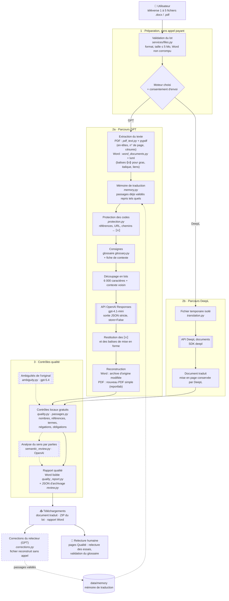
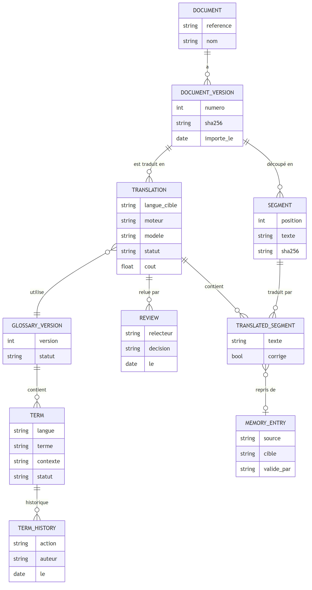
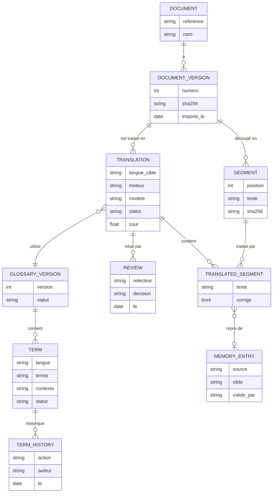

# Espace de traduction de documents

Prototype local qui traduit des documents **Word (`.docx`) et PDF** avec **GPT
(OpenAI)** ou **DeepL**, puis contrôle la qualité de la traduction avant relecture
humaine. Français, anglais britannique, espagnol et allemand sont proposés dans
les deux sens. Tous les résultats sont des **brouillons à relire**.

**Priorité actuelle : français → anglais britannique.** C'est la seule paire dont
la qualité a été mesurée par un essai réel ([résultats](evaluation/RESULTATS_2026-10-22.md)).
L'espagnol et l'allemand restent disponibles mais **non évalués** : l'application
l'indique et le rapport qualité le note (`language_pair_evaluated`).

## Sommaire

1. [Démarrage rapide](#démarrage-rapide)
2. [Comment fonctionne l'application](#comment-fonctionne-lapplication)
3. [Stack technique et raisons des choix](#stack-technique-et-raisons-des-choix)
4. [Utilisation](#utilisation)
5. [Configuration](#configuration)
6. [Qualité, tests et évaluation](#qualité-tests-et-évaluation)
7. [Organisation du code](#organisation-du-code)
8. [Documentation détaillée](#documentation-détaillée)
9. [Évolutions possibles](#évolutions-possibles)

## Démarrage rapide

### Avec Docker (recommandé)

Prérequis : Docker Desktop démarré avec les conteneurs Linux.

```powershell
# Si .env n'existe pas : Copy-Item .env.example .env, puis renseigner la clé
docker compose up -d --build
```

Ouvrir **http://localhost:8502**. L'accès est limité à cet ordinateur ; les clés
restent dans `.env` et ne sont jamais intégrées à l'image.

```powershell
docker compose ps                         # état des services
docker compose logs --tail 50 traduction  # journal (jamais le texte des documents)
docker compose down                       # arrêt
```

Après modification d'une clé : `docker compose up -d --force-recreate`. Après
modification du code : `docker compose up -d --build`. La mémoire de traduction
est conservée dans `data/memory/` (volume monté) ; les résultats d'une session
disparaissent au redémarrage.

### Avec Python local

```powershell
powershell -ExecutionPolicy Bypass -File .\start.ps1
```

Le script installe les dépendances, crée `.env` s'il n'existe pas et ouvre
l'application (en général `http://localhost:8501`). Équivalent manuel :

```powershell
python -m venv .venv
.\.venv\Scripts\python.exe -m pip install -r requirements.txt
Copy-Item .env.example .env   # puis renseigner OPENAI_API_KEY ou DEEPL_API_KEY
.\.venv\Scripts\python.exe -m streamlit run app.py
```

La page **Relecture des essais** lit `evaluation/runs/`, qui reste local : elle
n'affiche des essais qu'en Python local, pas dans Docker.

## Comment fonctionne l'application

### Parcours complet d'un document

Du téléversement au fichier traduit, avec les outils appelés à chaque étape.
Les cases en pointillé sont des options facultatives.


<details>
<summary>Source du schéma (Mermaid, modifiable)</summary>



</details>

### Ce qui est appelé à chaque étape

| Étape | Code | Outil ou service | Appel payant ? |
| --- | --- | --- | --- |
| Validation du lot | `services/files.py` | pypdf, lxml | Non |
| Extraction PDF et nettoyage | `services/pdf_text.py` | pypdf | Non |
| Extraction et réinsertion Word | `services/word_documents.py` | lxml (XML OOXML) | Non |
| Reprise de passages validés | `services/memory.py` | Fichier JSON local | Non |
| Protection des codes et liens | `services/protection.py` | Expressions régulières | Non |
| Traduction GPT | `services/openai_translation.py` | API OpenAI Responses (`gpt-4.1-mini`) | **Oui** |
| Traduction DeepL | `services/translation.py` | API DeepL documents | **Oui** |
| Repérage des ambiguïtés | `services/ambiguity.py` | API OpenAI (`gpt-5.4`) | **Oui, en option** |
| Contrôles locaux | `services/quality.py`, `services/passages.py`, `services/glossary.py` | Python | Non |
| Analyse du sens | `services/semantic_review.py` | API OpenAI | **Oui, en option** |
| Rapports | `services/quality_report.py`, `services/review.py` | python-docx, JSON | Non |
| Corrections | `services/corrections.py` | Réinsertion locale | Non |

Le lot entier est validé **avant** le premier appel facturé. Les documents sont
traités l'un après l'autre : une erreur sur un fichier n'empêche pas les
suivants. Les résultats restent en session, donc un téléchargement ne relance
jamais la traduction ; les lots GPT déjà payés sont mis en cache pendant la
session.

## Stack technique et raisons des choix

| Élément | Choix | Pourquoi ce choix |
| --- | --- | --- |
| Langage | **Python 3.13** | Un seul langage pour l'interface, les documents et les API ; SDK officiels OpenAI et DeepL disponibles |
| Interface web | **Streamlit 1.5x** | Import multiple, progression et téléchargements en quelques lignes ; pas de frontend séparé à maintenir pour un prototype ; menu de pages et thème clair/sombre intégrés |
| Traduction principale | **OpenAI `gpt-4.1-mini`** (API Responses) | Sortie JSON structurée qui garantit un bloc traduit par bloc source ; suit le glossaire et la fiche de contexte ; mesuré le 22/10/2026 : conserve toutes les balises Word (36/36), contrairement à `gpt-5.4-mini` (13 pertes) |
| Traduction alternative | **DeepL** (API documents) | Traduit le fichier complet en conservant sa mise en page ; utile comme point de comparaison |
| Ambiguïtés | **OpenAI `gpt-5.4`** | Mesuré : 4 ambiguïtés trouvées sur 4, sans faux doute ; un appel séparé évite de bruiter la traduction |
| Lecture PDF | **pypdf** | Extraction en mode mise en page, pure Python, sans dépendance système |
| Écriture PDF | **reportlab** | Génère un PDF propre avec les accents ; fiable pour une sortie simple |
| Word | **lxml** + **python-docx** | lxml modifie le texte dans l'archive d'origine sans toucher tableaux, images ni styles ; python-docx produit le rapport qualité |
| Stockage | **Fichiers JSON** (glossaire, mémoire, essais) | Aucun serveur à installer pour un prototype local ; lisible et versionnable ; écriture atomique. Limite : pas d'accès concurrent ni d'historique, voir les [évolutions](#évolutions-possibles) |
| Configuration | **python-dotenv** | Clés API dans `.env`, hors Git et hors image Docker |
| Conteneurs | **Docker + Compose** | Même environnement sur tout poste ; un service application et un service tests |
| Tests | **pytest** + Streamlit **AppTest** | Teste les services et l'interface avec de faux clients API : aucun coût, aucune clé |
| Qualité du code | **ruff** | Linter rapide, une seule configuration |
| CI | **GitHub Actions** | ruff, pytest et build Docker à chaque push |
| Dépendances | **uv** (fichiers `.lock`) | Versions exactes identiques entre poste, Docker et CI |

Ce qui a été volontairement écarté pour le prototype : comptes utilisateurs,
base de données, file de tâches, recherche vectorielle et embeddings. Ils ne
sont utiles qu'avec plusieurs utilisateurs ou de gros volumes.

## Utilisation

### Traduire un lot

1. **Documents** : importer 1 à 5 fichiers `.docx` ou `.pdf` (5 Mo maximum, texte
   sélectionnable).
2. **Langues et moteur** : choisir la langue du document, la langue souhaitée
   et le moteur, puis accepter l'envoi du contenu à ce moteur.
3. **Options de qualité** (facultatives) :
   - **fiche de contexte** : domaine, public, ton ;
   - **glossaire technique** : 55 notions en quatre langues ;
   - **contrôle du sens** après traduction : appel OpenAI payant ;
   - **repérage des ambiguïtés** de l'original : appel OpenAI payant ;
   - **mémoire de traduction** : reprend les passages déjà validés (GPT uniquement).
4. Cliquer sur **Traduire le lot**, puis pour chaque document :
   - télécharger la traduction, ou le ZIP du lot ;
   - ouvrir **Comparer les textes** : original et traduction côte à côte, avec les alertes ;
   - télécharger le **rapport qualité Word**, lisible par un relecteur non informaticien ;
   - avec GPT, **corriger** un passage : le fichier est reconstruit sans nouvel appel.

Pour imprimer, ouvrir le fichier téléchargé dans Word ou un lecteur PDF.

### Pages du groupe Qualité

- **Relecture des essais** : une décision humaine par traduction d'essai, et
  bilan face aux alertes automatiques.
- **Validation du glossaire** : relecture des notions, puis validation
  déclarée. Le glossaire validé est ensuite utilisé par défaut.

### Moteurs : ce qui change

| | GPT | DeepL |
| --- | --- | --- |
| Word | Texte remplacé dans le fichier d'origine : tableaux, images, styles et liens conservés | Mise en page conservée par DeepL |
| PDF | Nouveau PDF simple, sans images ni tableaux | Mise en page conservée au mieux |
| Glossaire | Termes utiles ajoutés aux consignes | Non transmis (contrôle local seulement) |
| Fiche de contexte | Domaine, public et ton | Ton seulement (formalité) |
| Mémoire et corrections | Oui | Non |
| Limite | 60 000 caractères par document | Limites du compte DeepL |

Les champs automatiques, les commentaires Word et le texte dans les images ne
sont pas traduits. Un texte plus long peut décaler les sauts de page. Les PDF à
plusieurs colonnes peuvent être lus dans un ordre imparfait. Les PDF scannés
(images) ne sont pas pris en charge.

### Documents de test

- `examples/tests/` : 5 documents français conçus pour éprouver les contrôles :
  - mise en forme Word ;
  - tableaux de mesures ;
  - code à ne pas traduire ;
  - contrat avec délais et pénalités ;
  - phrases ambiguës.
- `examples/*.pdf` : 3 PDF fictifs (fiche de suivi, rapport d'incident, coordination entre entreprises).

Tous les noms et événements sont fictifs.

## Configuration

```dotenv
OPENAI_API_KEY=votre_cle_openai
OPENAI_MODEL=gpt-4.1-mini          # modèle de traduction
OPENAI_REVIEW_MODEL=               # analyse du sens (vide = même modèle)
OPENAI_AMBIGUITY_MODEL=            # ambiguïtés (vide = gpt-5.4)
DEEPL_API_KEY=                     # facultatif
LOG_LEVEL=INFO
APP_NAME=                          # identité de l'entreprise, voir docs/branding.md
APP_LOGO=
APP_LOGO_DARK=
APP_LOGO_ICON=
```

- Les deux clés sont indépendantes. Sans clé pour le moteur choisi, le bouton
  est désactivé : il n'y a aucune fausse traduction de démonstration.
- Les appels OpenAI utilisent `store=False`, une sortie JSON stricte et aucune
  relance automatique, sauf en cas de limite de débit.
- Une réponse incomplète n'est jamais exportée.
- Le journal contient durées, tailles, nombre d'appels et types d'erreur, mais
  jamais le nom ni le texte des documents.
- Nom, logos et couleurs se règlent sans code, dans `.env` et
  `.streamlit/config.toml` : voir [Adapter l'identité](docs/branding.md).

## Qualité, tests et évaluation

Il faut distinguer trois choses :

1. **Les tests automatiques (245)** vérifient le fonctionnement avec de faux
   clients API. Ils ne mesurent pas la qualité linguistique.
2. **Les contrôles de l'application** signalent des écarts : nombres,
   références, termes, négations, obligations. **L'absence d'alerte ne valide
   pas le sens.**
3. **La qualité réelle** se mesure par des essais réels et une relecture
   bilingue et métier. Un premier essai a eu lieu le 22 octobre 2026
   ([résultats](evaluation/RESULTATS_2026-10-22.md),
   [bilan Word](docs/Bilan_evaluation_qualite_FR-EN.docx), régénérable avec
   `python -B -m evaluation.bilan_qualite`). La relecture humaine reste à faire.

Le glossaire fourni (version 4, 55 notions) a le statut **proposed** : ce sont
des propositions sans validation métier. Voir le [guide du glossaire](docs/glossary.md).

### Lancer les tests

```powershell
.\.venv\Scripts\python.exe -m pip install -r requirements-dev.txt
.\.venv\Scripts\python.exe -m pytest -q
.\.venv\Scripts\python.exe -m ruff check .
```

Dans Docker Desktop, ouvrir Containers, puis le groupe du projet, puis `tests`,
puis Logs. `Exited (0)` signifie que tous les tests sont passés. **Start**
relance les tests sur le code local, monté en lecture seule, sans reconstruire
l'image.

Après une modification de `requirements*.txt`, régénérer les versions exactes
(Linux, Python 3.13) :

```powershell
uv pip compile requirements.txt --python-version 3.13 --python-platform linux -o requirements.lock --no-header
uv pip compile requirements-dev.txt --python-version 3.13 --python-platform linux -o requirements-dev.lock --no-header
```

### Historique des vérifications

| Date | Tests | Ajout principal |
| --- | --- | --- |
| 23/10/2026 | 245 | Refonte visuelle : thème clair et sombre, logo, menu en haut, page en étapes |
| 23/10/2026 | 238 | Analyse du sens par parties, rapport qualité Word, termes passage par passage |
| 22/10/2026 | 224 | Pages de relecture des essais et de validation du glossaire |
| 22/10/2026 | 215 | Corrections et mémoire de traduction |
| 22/10/2026 | 198 | Fiche de contexte, ambiguïtés, glossaire version 4 |
| 22/10/2026 | 181 | Premier essai réel, paragraphes Word entiers avec balises |
| 21/10/2026 | 167 | Nettoyage PDF, protection des codes, contrôles par passage |
| 21/10/2026 | 130 | Corrections de l'audit, versions verrouillées |
| 12/10/2026 | 18 | Première version, premier essai OpenAI réel vérifié visuellement |

## Organisation du code

```text
platforme/
├── app.py                  # Point d'entrée : identité visuelle et menu
├── app_pages/              # Traduire, Relecture des essais, Validation du glossaire
├── assets/                 # Logos remplaçables par ceux de l'entreprise
├── services/               # Logique métier (voir le tableau des étapes ci-dessus)
├── data/glossaries/        # Glossaire multilingue versionné (JSON)
├── data/memory/            # Mémoire de traduction locale (exclue de Git)
├── docs/                   # Guides détaillés et bilan d'évaluation
├── evaluation/             # Corpus, essais réels et protocole de relecture
├── examples/               # Documents fictifs de test
├── tests/                  # Tests unitaires et d'interface (clients simulés)
├── Dockerfile, compose.yaml
├── requirements*.txt/.lock # Dépendances (plages) et versions exactes
├── .github/workflows/      # CI : ruff, pytest, build Docker
└── .env.example            # Modèle de configuration (.env exclu de Git)
```

## Documentation détaillée

| Sujet | Document |
| --- | --- |
| Architecture et parcours complet | [docs/architecture.md](docs/architecture.md) |
| Glossaire : usage, variantes, validation | [docs/glossary.md](docs/glossary.md) |
| Traduction Word et conservation de la structure | [docs/word-translation.md](docs/word-translation.md) |
| Découpage avec contexte et fidélité | [docs/translation-context.md](docs/translation-context.md) |
| Analyse du sens | [docs/semantic-review.md](docs/semantic-review.md) |
| Ambiguïtés et fiche de contexte | [docs/ambiguity-and-brief.md](docs/ambiguity-and-brief.md) |
| Corrections et mémoire de traduction | [docs/translation-memory.md](docs/translation-memory.md) |
| Tests, mocks et limites des contrôles | [docs/quality-and-tests.md](docs/quality-and-tests.md) |
| Identité visuelle de l'entreprise | [docs/branding.md](docs/branding.md) |
| Protocole d'évaluation | [evaluation/README.md](evaluation/README.md) |
| Passage en entreprise | [docs/enterprise.md](docs/enterprise.md), [dossier détaillé](docs/DOSSIER_PROJET_ET_ARCHITECTURE.md) |

## Évolutions possibles

Ce sont des propositions : rien de ce qui suit n'est encore réalisé. Elles sont
classées par intérêt pour le projet.

### 1. Ajouter une base de données (priorité)

Aujourd'hui, glossaire, mémoire et essais sont des fichiers JSON. C'est simple,
mais cela n'offre ni historique, ni recherche, ni travail à plusieurs. Une base
**SQLite** suffirait pour le poste local, et **PostgreSQL** conviendrait pour un
usage partagé. Elle apporterait les gains suivants.

**Ne jamais retraduire un document déjà traduit**
- Chaque fichier importé est identifié par son **empreinte SHA-256**.
- Si la même empreinte existe déjà pour la même langue cible, l'application
  l'annonce directement : « Ce document a déjà été traduit le 22/10/2026 avec
  GPT (glossaire v4). Télécharger la traduction existante ? » Il n'y a alors
  aucun appel et aucun coût.
- Si le document est une **nouvelle version** d'un document connu (même
  référence ou même nom, contenu différent), l'application affiche : « La
  version 2 de ce document est déjà traduite. Seuls 3 paragraphes ont changé. »
  Elle ne retraduit que les paragraphes modifiés et reprend les autres
  depuis la version précédente, avec leurs corrections humaines.
- Le relecteur voit les différences entre versions, source et traduction.

**Glossaire géré dans l'application**
- Ajouter, modifier ou retirer un terme depuis une page, sans éditer de JSON.
- Garder l'historique de chaque terme : qui l'a proposé, validé ou modifié, et quand.
- Gérer un statut par terme et par langue (proposé, validé, interdit) plutôt
  qu'un statut global.
- Avoir plusieurs glossaires par domaine ou par client.
- Chaque traduction note la version exacte du glossaire utilisée.

**Historique et traçabilité**
- Garder la liste des traductions : document, version, moteur, modèle,
  langues, date et coût estimé.
- Suivre les décisions de relecture rattachées à une traduction précise, avec
  leur statut (brouillon, relu, approuvé).
- Afficher un tableau de bord qualité : taux d'alertes par moteur, corrections
  les plus fréquentes, termes souvent manqués.

**Mémoire de traduction plus fiable**
- Recherche rapide, y compris de passages *proches* et pas seulement identiques.
- Origine de chaque passage : document, relecteur, date.
- Export au format standard **TMX**, utilisable dans les outils de traduction
  professionnels.

Schéma possible :



<details>
<summary>Source du schéma (Mermaid, modifiable)</summary>



</details>

### 2. Améliorer la traduction

- **Glossaire natif DeepL** : transmettre le glossaire validé à DeepL, qui
  l'ignore aujourd'hui.
- **PDF avec mise en page** pour GPT : reconstruire tableaux et images au lieu
  d'un PDF simple, ou convertir le PDF en Word avant traduction.
- **OCR** pour les PDF scannés, par exemple avec Tesseract.
- **Recollement des césures** à l'aide d'un dictionnaire : aujourd'hui, un mot
  coupé en fin de ligne n'est recollé que s'il apparaît ailleurs entier dans
  le document.
- **Plusieurs langues cibles** en un seul lot.
- **Détection automatique** de la langue source.
- Évaluer l'espagnol et l'allemand avec le même protocole que le français →
  anglais.

### 3. Travail en équipe et passage en entreprise

- **Authentification** par l'annuaire de l'entreprise (SSO ou OIDC), avec des
  rôles : traducteur, relecteur, administrateur du glossaire.
- **Circuit de validation** : brouillon, puis relu, puis approuvé, avec
  notification du relecteur.
- **Traitements en arrière-plan** (file de tâches) : la traduction continue
  même si le navigateur est fermé.
- **Stockage privé** des fichiers, avec une durée de conservation et une
  suppression automatique (RGPD).
- Une **API** (FastAPI) pour brancher la traduction sur d'autres outils de
  l'entreprise.

### 4. Coûts et exploitation

- **Estimation du coût avant envoi** et **plafond** par jour ou par utilisateur.
- **Suivi des dépenses** par moteur, par utilisateur et par mois.
- Supervision et sauvegardes de la base et de la mémoire.

### 5. Confort d'utilisation

- **Aperçu PDF** et impression directement dans le navigateur.
- Traduction en français des textes du bouton d'import (« Upload »,
  « 5MB per file »). Ils viennent de Streamlit et demandent un composant
  personnalisé.
- **Export XLIFF** des textes à relire, pour les traducteurs professionnels.

## Documentation officielle

- [Streamlit : import de fichiers](https://docs.streamlit.io/develop/api-reference/widgets/st.file_uploader)
- [DeepL : API et traduction de documents](https://www.deepl.com/en/developers)
- [DeepL : langues prises en charge](https://developers.deepl.com/docs/resources/supported-languages)
- [DeepL : SDK Python officiel](https://github.com/DeepLcom/deepl-python)
- [OpenAI : génération de texte avec Responses](https://developers.openai.com/api/docs/guides/text)
- [OpenAI : sorties structurées](https://developers.openai.com/api/docs/guides/structured-outputs)
