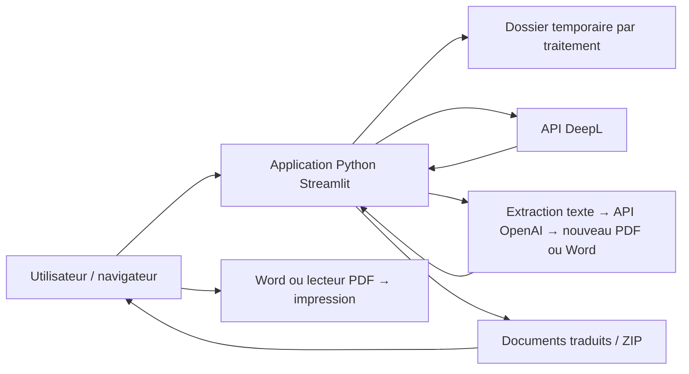

# Espace de traduction de documents

## Contrôle de qualité et évaluation

Les résultats sont présentés comme des brouillons à relire. Après traduction,
des contrôles locaux signalent les écarts de nombres et de références dans
le texte extractible, avec un rapport JSON téléchargeable, sans appel IA
supplémentaire. L'absence d'alerte ne valide pas le sens de la traduction.
Le [protocole d'évaluation](evaluation/README.md) propose un corpus fictif de
20 passages, un formulaire d'essai et un rapport séparant alertes automatiques
et décisions humaines. Aucun score de qualité réelle n'a encore été mesuré
avec ce protocole.

## Objectif

Une petite application web permettant d'importer plusieurs documents, de choisir leur langue et une langue de destination, puis de récupérer les documents traduits pour les imprimer. Français, anglais, espagnol, allemand et chinois simplifié sont disponibles dans les deux sens.

L'application est implémentée en Python et Streamlit. Elle propose uniquement la traduction de documents avec deux moteurs au choix : GPT (OpenAI) et DeepL. Configurez la clé du moteur choisi dans `.env`.

## Parcours utilisateur

1. Importer un ou plusieurs fichiers Word (`.docx`) ou PDF (`.pdf`).
2. Choisir la **Langue du document** et la **Langue souhaitée** pour le lot : français, anglais, espagnol, allemand ou chinois simplifié. Tous les fichiers du lot doivent partager la même langue source. Deux langues identiques désactivent la traduction.
3. Choisir **OpenAI** ou **DeepL**, accepter l'envoi du contenu au moteur choisi, puis cliquer sur **Traduire le lot**.
4. Voir l'avancement et le résultat de chaque fichier.
5. Télécharger chaque document traduit ou une archive ZIP contenant tous les résultats.
6. Ouvrir le document téléchargé dans Word ou un lecteur PDF et cliquer sur **Imprimer**.

Pour cette première version, l'impression utilise le logiciel de l'utilisateur. Un bouton dans l'application web ne peut pas imprimer directement un fichier Word téléchargé. Un aperçu PDF avec impression dans le navigateur pourra être ajouté ensuite.

## Stack recommandée : le minimum nécessaire

| Élément | Choix | Rôle |
| --- | --- | --- |
| Langage | Python | Toute la logique dans un seul langage |
| Interface web et serveur | Streamlit | Import, choix de langue, progression et téléchargement |
| Traduction | API DeepL + SDK Python `deepl` | Traduire les documents complets en conservant au mieux leur mise en forme |
| Traduction pour les essais | API OpenAI + SDK Python `openai` | Traduire le texte extrait et reconstruire un document simple |
| Reconstruction de documents | `reportlab`, `python-docx`, `pypdf` | Lire le texte et générer les PDF ou Word avec OpenAI |
| Configuration locale | `python-dotenv` | Charger la clé API depuis un fichier `.env` |
| Fichiers temporaires et ZIP | Bibliothèque standard Python | `tempfile`, `pathlib` et `zipfile` |

Une seule application, sans frontend séparé, sans base de données et sans comptes utilisateurs pour le prototype local. Un compte API du fournisseur choisi est nécessaire ; prévoir un budget selon ses quotas et sa facturation. Cette solution nécessite une connexion Internet.

Streamlit prend en charge l'import de plusieurs fichiers. DeepL propose une API de traduction de documents, notamment Word et PDF. La conservation exacte de la mise en page doit être vérifiée sur les documents réels, surtout pour les PDF complexes.

## Architecture



### Répartition des fichiers proposée

```text
platforme/
├── app.py                  # Interface et coordination du traitement
├── services/
│   ├── translation.py      # Appels à DeepL et suivi de la traduction
│   ├── openai_translation.py # Extraction, OpenAI et reconstruction
│   └── files.py            # Validation, fichiers temporaires et ZIP
├── requirements.txt        # Dépendances Python de l'application
├── .env.example            # Configuration des deux fournisseurs
├── .env                    # Clé locale, exclue de Git
├── .gitignore              # .env, .venv/, __pycache__/
└── README.md
```

Le projet inclut également `examples/` (trois PDF fictifs) et `tests/` (vérifications du traitement et de l'interface).

### Traitement d'un lot

1. Valider le nombre, le format et la taille des fichiers avant l'envoi.
2. Pour DeepL, créer un dossier temporaire isolé par document et utiliser des noms internes uniques. Pour OpenAI, extraire et reconstruire le texte en mémoire.
3. Transmettre la langue source et la langue cible choisies à chaque document. Par exemple anglais → français ou chinois → français.
4. Traiter les fichiers l'un après l'autre : envoyer, attendre le résultat, récupérer le document traduit.
5. Afficher un état par fichier : en attente, en cours, terminé ou en erreur.
6. Conserver les résultats en mémoire pour les téléchargements, puis supprimer les fichiers temporaires avec un gestionnaire de contexte.
7. En cas d'erreur sur un document, continuer les autres et proposer une relance explicite du fichier en échec.

Utiliser l'état de session Streamlit pour conserver les résultats et éviter qu'un téléchargement déclenche une nouvelle traduction. Ne pas partager les documents entre utilisateurs via un cache global.

## Langues

| Choix affiché | Code cible DeepL |
| --- | --- |
| Anglais britannique | `EN-GB` |
| Espagnol | `ES` |
| Allemand | `DE` |
| Chinois simplifié | `ZH-HANS` |
| Français | `FR` |

Les codes source DeepL sont `FR`, `EN`, `ES`, `DE` et `ZH`. Les variantes cibles `EN-GB` et `ZH-HANS` sont normalisées pour détecter les choix de même langue. GPT reçoit les noms complets des langues source et cible dans ses instructions. La détection automatique n'est pas activée ; le choix est manuel.

Vérifier les langues disponibles auprès de l'API lors de l'intégration. Pour commencer, une seule langue cible par lot suffit.

## Périmètre de la première version

- Import multiple de fichiers `.docx` et `.pdf` contenant du texte.
- Limites applicatives proposées : 5 fichiers par lot et 5 Mo par fichier, à ajuster aux limites du compte API.
- Traduction du document complet par DeepL, sans extraction et reconstruction manuelle des paragraphes.
- Avec OpenAI : extraction du texte du PDF ou du corps Word et des tableaux, traduction puis reconstruction dans le format d'origine. Limite de 60 000 caractères par document, découpés en requêtes de 6 000 caractères au maximum.
- Sortie dans le format d'origine, avec un nom comme `rapport_EN-GB.docx`.
- Téléchargement individuel et ZIP des traductions réussies.
- Message clair si un format, une taille ou un document ne peut pas être traité.

Les PDF scannés, les images, la conversion systématique Word → PDF, l'historique, les comptes et le choix de plusieurs langues simultanées sont hors du premier périmètre. Ils pourront être ajoutés selon les besoins.

## Configuration et lancement prévus

### Docker local

Prérequis : Docker Desktop démarré avec les conteneurs Linux. Les clés restent dans le fichier `.env` local et sont injectées au démarrage ; `.env`, l'historique, les fichiers temporaires et `.venv` sont exclus du contexte de construction. Aucune clé n'est intégrée à l'image.

Depuis PowerShell dans le dossier du projet :

```powershell
# Si .env n'existe pas encore, le créer depuis .env.example puis renseigner la clé
docker compose up -d --build
```

Ouvrir **http://localhost:8502**. Le port 8502 évite le conflit avec l'application Python locale sur 8501. L'accès est limité à cet ordinateur.

```powershell
docker compose ps
docker compose logs --tail 50 traduction
docker compose down
```

Après modification d'une clé dans `.env`, appliquer `docker compose up -d --force-recreate`. Après modification du code, appliquer `docker compose up -d --build`. Les résultats de traduction sont propres à la session ; un redémarrage du conteneur les efface.

L'image locale est nommée `platforme-traduction:local`. Aucun envoi vers Docker Hub n'est effectué.

### Python local

Depuis PowerShell dans le dossier du projet :

Vous pouvez lancer `powershell -ExecutionPolicy Bypass -File .\start.ps1` pour installer les dépendances et ouvrir l'application locale. Le script crée `.env` uniquement s'il n'existe pas. Renseignez votre clé dans ce fichier puis redémarrez l'application. L'interface est accessible à l'adresse indiquée par Streamlit, généralement `http://localhost:8501`.

```powershell
python -m venv .venv
.\.venv\Scripts\python.exe -m pip install -r requirements.txt
Copy-Item .env.example .env
# Renseigner OPENAI_API_KEY ou DEEPL_API_KEY dans .env
.\.venv\Scripts\python.exe -m streamlit run app.py
```

Les clés API restent côté serveur. Le contenu est envoyé uniquement au fournisseur sélectionné ; l'interface l'indique avant le traitement. Aucun basculement automatique vers l'autre fournisseur. Pour une utilisation publique, ajouter un accès protégé et des limites d'usage avant l'ouverture du service.

### Configuration OpenAI et DeepL

```dotenv
OPENAI_API_KEY=votre_cle_openai
OPENAI_MODEL=gpt-4.1-mini
DEEPL_API_KEY=
```

Vous pouvez laisser `DEEPL_API_KEY` vide pour l'instant et l'ajouter plus tard. Les deux clés sont indépendantes. OpenAI est proposé par défaut dans l'interface. Le modèle est configurable via `OPENAI_MODEL` ; il doit être accessible au compte et prendre en charge Responses et les sorties structurées. L'API OpenAI est facturée à l'usage et nécessite un crédit API utilisable.

OpenAI recrée un document avec une mise en page simple : images, styles, structure visuelle des tableaux, en-têtes et pieds de page ne sont pas conservés. Les lignes du PDF sont traduites selon l'ordre d'extraction ; les PDF à plusieurs colonnes peuvent donner un ordre imparfait. Les fichiers Word contiennent le texte du corps et des cellules de tableau, dans leur ordre de lecture. Pour les PDF chinois, une police CJK est utilisée ; pour Word, une police asiatique est déclarée. Relire les traductions techniques avant utilisation.

Les appels OpenAI utilisent `store=False`, une sortie JSON structurée et aucune relance automatique. Une réponse refusée, tronquée ou comportant un nombre incorrect de blocs n'est pas exportée. Si une requête échoue après le début du traitement, les requêtes déjà effectuées peuvent avoir consommé du crédit. Une relance manuelle retraduit le document complet.

Sans clé API pour le moteur choisi, le bouton de traduction est désactivé. L'application ne fournit pas de fausse traduction de démonstration. Les résultats restent dans la session jusqu'à leur effacement ou la fin de la session ; un téléchargement ne relance pas l'appel API. Pour relancer un échec, importer uniquement le fichier concerné. Les validations du lot sont réalisées avant tout appel de traduction ; les erreurs du service sur un fichier n'empêchent pas de traiter les suivants.

### Documents de simulation

- `examples/fiche_suivi_technique_FR.pdf` : suivi d'une anomalie fictive et des contributions de maintenance.
- `examples/rapport_incident_FR.pdf` : événement simulé, chronologie, impact et suivi.
- `examples/processus_coordination_entreprises_FR.pdf` : échanges entre l'exploitant fictif RailNova Services et le prestataire Atelier Nord.

Tous les noms et événements sont fictifs. Ces documents pédagogiques ne constituent pas des procédures opérationnelles ferroviaires. Ils contiennent du texte sélectionnable pour tester la traduction. Ces fichiers servent uniquement de données de test locales ; ils ne sont plus affichés dans l'application ni intégrés à l'image Docker.

### Lancer les tests

```powershell
.\.venv\Scripts\python.exe -m pip install -r requirements-dev.txt
.\.venv\Scripts\python.exe -m pytest -q
```

Les tests de traduction utilisent des clients simulés, sans transmission ni facturation. Ils vérifient les deux moteurs, l'absence de retraduction au téléchargement, les résultats incomplets, l'extraction Word et les caractères chinois dans les PDF. Une vérification avec un véritable compte OpenAI ou DeepL reste nécessaire pour confirmer le rendu traduit et les limites du compte.

Validation du 12 octobre 2026 : 18 tests passent. Un rapport d'incident fictif a été traduit vers l'anglais avec l'API OpenAI réelle et le PDF obtenu a été vérifié visuellement. Les sorties PDF dans les quatre langues ont été vérifiées avec des textes de contrôle, sans appels de traduction supplémentaires. La traduction réelle en espagnol, allemand et chinois et les appels DeepL restent à vérifier. Les premiers essais OpenAI incomplets ont été rejetés ; le schéma exige désormais une propriété obligatoire pour chaque bloc de texte.

## Ordre de réalisation

1. Interface : import multiple, langue et bouton Traduire.
2. Traduction d'un fichier Word de bout en bout.
3. Traitement de plusieurs documents et affichage des erreurs individuelles.
4. Support des PDF textuels et téléchargement ZIP.
5. Vérification de la mise en page et de l'impression sur un exemple par langue.

Critères de validation : un lot de plusieurs documents se traduit dans chacune des quatre langues ; les fichiers récupérés s'ouvrent et s'impriment ; une erreur isolée ne bloque pas le lot ; télécharger un résultat ne refacture pas une traduction.

## Documentation officielle

- [Streamlit : import de fichiers et import multiple](https://docs.streamlit.io/develop/api-reference/widgets/st.file_uploader)
- [DeepL : API pour développeurs et traduction de documents](https://www.deepl.com/en/developers)
- [DeepL : langues prises en charge](https://developers.deepl.com/docs/resources/supported-languages)
- [DeepL : SDK Python officiel](https://github.com/DeepLcom/deepl-python)
- [OpenAI : génération de texte avec Responses](https://developers.openai.com/api/docs/guides/text)
- [OpenAI : sorties structurées](https://developers.openai.com/api/docs/guides/structured-outputs)
- [OpenAI : modèle GPT-4.1 mini](https://developers.openai.com/api/docs/models/gpt-4.1-mini)
