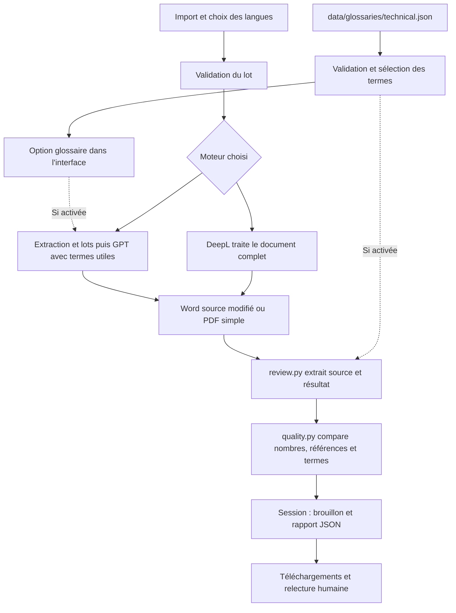

# Architecture du prototype

L'application reste un seul programme Python avec une interface Streamlit.
Les responsabilités sont séparées sans ajouter de base de données ni de
serveur supplémentaire. `app.py` compose les services et garde les résultats
dans la session de l'utilisateur ; les services ne dépendent pas de Streamlit.

## Dossiers et responsabilités

```text
platforme/
├── app.py                         Interface, choix, progression, téléchargements
├── services/
│   ├── files.py                   Validation des fichiers, noms de sortie, ZIP
│   ├── translation.py             Langues, appel DeepL, messages d'erreur
│   ├── openai_translation.py      Extraction, lots, appel GPT, reconstruction
│   ├── word_documents.py          Réinsertion du texte dans le DOCX source
│   ├── glossary.py                Validation du JSON, sélection, consignes, termes
│   ├── quality.py                 Contrôles locaux des nombres, références, termes
│   └── review.py                  Extraction après traduction et rapport traçable
├── data/glossaries/
│   └── technical.json             Vocabulaire multilingue versionné
├── tests/                         Tests unitaires et parcours Streamlit simulés
├── evaluation/
│   ├── corpus.json                20 passages fictifs pour une évaluation humaine
│   ├── run.py                     Préparation et bilan d'un essai, sans API
│   ├── README.md                  Protocole d'évaluation linguistique
│   └── runs/                      Essais locaux, ignorés par Git
├── examples/                      Trois PDF fictifs pour les tests
├── docs/                          Architecture, glossaire, conception entreprise
├── .streamlit/config.toml         Taille d'import et thème
├── Dockerfile                     Images séparées application / tests
├── compose.yaml                  Services traduction et tests
├── requirements.txt              Dépendances d'exécution
├── requirements-dev.txt          Dépendances de test
├── .env.example                  Modèle de configuration sans secrets
├── .env                          Clés locales, ignorées par Git et Docker build
└── README.md                      Point d'entrée de la documentation
```

## Parcours d'une traduction



1. Les choix de langues sont validés ; une même langue source et cible est refusée.
2. Le glossaire est lu depuis un chemin relatif au projet, indépendant du dossier
   de lancement. Un fichier absent ou invalide désactive son option et affiche
   un avertissement ; il ne provoque pas de basculement vers un autre moteur.
3. Les fichiers du lot sont vérifiés avant le premier appel facturable.
4. Si le glossaire est activé, GPT reçoit les entrées rencontrées dans chaque
   lot avec leur contexte. DeepL reçoit les mêmes paramètres qu'avant : cette
   version ne crée ni ne transmet de glossaire distant DeepL.
5. Le document traduit est réextrait pour les contrôles. L'échec d'extraction
   donne un rapport `unavailable` ; le document reste téléchargeable.
6. Les écarts sont des alertes à relire. Le rapport enregistre le fournisseur,
   modèle GPT, langues et, si utilisé, identifiant, version, statut et empreinte
   SHA-256 du glossaire. Aucun statut d'approbation du document n'est produit.
7. Les résultats restent en session : changer le moteur ou décocher le glossaire
   après traduction ne modifie pas le rapport du lot déjà traité et ne refait
   pas d'appel API.

Pour Word, `word_documents.py` conserve l'archive source et ses propriétés.
Le même ordre de groupes textuels est utilisé pour l'extraction et la
réinsertion ; les longs groupes répartis sur plusieurs requêtes reviennent
à leur emplacement d'origine. Seuls les nœuds de texte du corps, des en-têtes
et pieds de page changent. Les tableaux et images ne sont pas reconstruits.
Voir [les limites de conservation Word](word-translation.md).

## Tests et Docker

Le service `traduction` sert l'application sur le port local 8502. Son image
inclut le glossaire, mais ni tests, ni exemples, ni dossiers d'évaluation.
Le service `tests` utilise une image dédiée, sans réseau ni clé. Les dossiers
locaux du code, des tests, des exemples, de l'évaluation et du glossaire sont
montés en lecture seule. Start dans Docker Desktop relance la suite sur ces
fichiers. Les changements de dépendances nécessitent une reconstruction.
L'application utilise sa copie intégrée : reconstruire après un changement
de code ou de glossaire pour actualiser le service `traduction`.

La comparaison linguistique réelle reste dans le protocole
[d'évaluation](../evaluation/README.md). Les tests techniques simulés ne prouvent
pas que les termes proposés sont corrects ni qu'un moteur les respecte en
conditions réelles.

Le [dossier entreprise](DOSSIER_PROJET_ET_ARCHITECTURE.md) conserve l'analyse
détaillée et des évolutions proposées. Ce document décrit l'architecture
actuelle du prototype.
